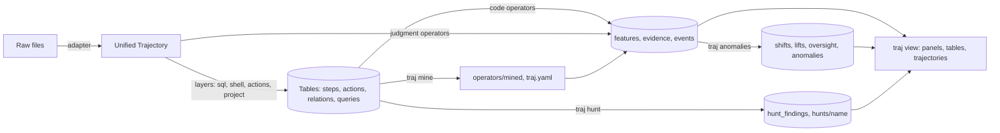

# traj-analyzer design

## 1. Goal

traj-analyzer analyses batches of LLM trajectories in any format, at low cost in people and model calls.
It turns every trajectory into features that go on a dashboard, finds the batches and trajectories that stand apart, and leads from a panel or an alert to the trajectory and the step where something went wrong.
Features come from code, which runs on every trajectory, or from judgments, one model call per trajectory or per window with a structured answer; the expensive multi-step agents run only when features are mined and when their tails are checked.
A dataset is not assumed to carry labels: the quality signals a trajectory itself shows, such as the user correcting or giving up, are extracted like any other feature, and labels, where a dataset has them, only check the method.

The repository holds what no scenario owns: the trajectory schema, the parsing layers for SQL, shell and tool calls, the feature forms, the extraction, the anomaly detection, the dashboard and the mining loop.
A scenario project adds its adapter, its configuration, and the operators, event rules and layers that need the scenario's meaning; the mining loop writes most of those.

Both people and agents use it.
Every command runs non-interactively, prints one JSON document to stdout, or CSV for `traj table` and `traj query`, and writes logs to stderr.

## 2. Overall flow



The work splits into two layers:

| Layer | Responsibility | Form |
|---|---|---|
| `traj` CLI | ingest, render, chunk, run the parsing layers, manage operators, schedule extraction, store, vectorize, detect anomalies, sample, mine, hunt | Python package with deterministic steps, a typer application |
| Shared agent skills | write operators, read samples, write reports, feed findings back into operators and config | `.claude/skills/` holds the content, `.agents/skills/` links to it for Codex; both are installed by `traj init` |

Three kinds of computation differ in cost, and the configuration keeps each where it belongs:

| Kind | Form | Runs on |
|---|---|---|
| code | an operator that reads the trajectory and its tables | every trajectory, on every `traj extract` |
| judgment | one model call with a structured answer, no tools, over a trajectory, every turn of it, or one window | every trajectory, or a sample per batch, or the trajectories inside a scope |
| function | a multi-step aifn agent with a workspace and a shell | once per scenario in `traj mine`, and a few calls per candidate for the tail check; one proposal and the reading calls of every round of `traj hunt` |

The skills are written once, in `.claude/skills/` of the tool repository.
The project template `src/traj_analyzer/templates/project/claude/skills/` holds a symbolic link to each skill file, so the package ships their content, and a new skill file needs a link there as well.
Codex discovers the same repository skills through relative directory links in `.agents/skills/`.
`traj init` copies the packaged skill files into the analysis project's `.claude/skills/` and links each `.agents/skills/<name>` directory to `../../.claude/skills/<name>`.
Linking the whole skill directory shares `SKILL.md` and any scripts, references or assets.
The links stay valid when the analysis project is moved.
The initializer discovers all bundled skill directories and checks for conflicting Codex destinations before copying files.
An existing matching link is reused; a conflicting destination is a configuration error even with `--force`.

## 3. Analysis project

The tool repository and analysis projects are separate.
An analysis project is a git repository created by `traj init <dir>`:

| Path | Content | In git |
|---|---|---|
| `traj.yaml` | datasets, layers, enabled operators, call groups, batches, strata, alerts, labels, rendering, engine, extraction concurrency | yes |
| `pyproject.toml` | optional; libraries the project's operators and adapters import, next to traj-analyzer itself, so `uv run traj` in the project uses them | yes |
| `operators/**/*.py` | project operators, one per file | yes |
| `layers/*.py` | project parsing layers, one per file | yes |
| `samplers/<name>.yaml` | sampling strategies | yes |
| `adapters/*.py` | project adapters, one per file | yes |
| `reports/*.md` | reports written by Codex or Claude Code | yes |
| `reviews/verdicts.jsonl` | what people found on the trajectories a feature pointed to, written by `traj review` (section 16) | yes |
| `hunts/<name>.yaml` | what a hunt looks for and how much it reads (section 18) | yes |
| `hunts/<name>/` | the facets and probes the last run of the hunt kept, which the next run starts from | yes |
| `.claude/skills/` | shared skill content copied from the tool repository | yes |
| `.agents/skills/<name>` | relative directory links to the shared skills for Codex | yes |
| `.traj/datasets/<dataset>/` | `<id>.json`, `<id>.md`, `index.jsonl` | no |
| `.traj/instructions/` | instruction files generated for call groups | no |
| `.traj/mailbox/` | aifn tasks and conclusions, which also serve as the cache | no |
| `.traj/features/<group>.parquet` | feature table | no |
| `.traj/tables/<name>.parquet` | the tables of section 14: steps, trajectories, the layer tables, evidence, events, judgments, shifts, lifts, oversight, anomalies, and `hunt_findings` of section 18 | no |
| `.traj/windows/<group>/<dataset>/<id>.<k>.md` | the rendered windows of a call group over windows | no |
| `.traj/samples/<sampler>/<run>/selection.json` | sampling results | no |
| `.traj/evaluation/` | second measurements per group and `features.json`, the result of `traj evaluate` | no |
| `.traj/mining/<round>/` | the workspace, trial values and `report.json` of one mining round | no |
| `.traj/mining/scenario.md` | what the trajectories are, as the last finished mining round described it | no |
| `.traj/hunts/<name>/<run>/` | the workspace, the state after every round, the clusters and `report.json` of one run of a hunt | no |

`traj mine` writes the code operators it accepts to `operators/mined/<name>.py` and the judgment features it accepts to `traj.yaml`, so they are in git like every other operator.

Every change to operators, configuration, samplers and reports can be traced through diffs and commit messages.
Everything under `.traj/` can be regenerated from those files and the raw data.

## 4. Unified trajectory

| Type | Field | Meaning |
|---|---|---|
| Trajectory | `id` | unique within the dataset |
| | `dataset` | dataset name |
| | `metadata` | any key-value pairs, such as cwd, model, title or reward |
| | `steps` | list of Step |
| | `harness` | the harness that ran the agent, naming the profile of section 13.1 that reads its tool calls; empty when the adapter knows no harness |
| Step | `index` | step number starting at 0 |
| | `role` | `user`, `assistant`, `tool`, `system` |
| | `kind` | `message`, `thinking`, `tool_call`, `tool_result`, `notice` |
| | `content` | text |
| | `name` | tool name for `tool_call` and `tool_result`, or the name of a `notice`: `interruption` when the user interrupted the assistant, `injected` when the harness or the dataset inserted the text |
| | `is_error` | whether a `tool_result` is an error |
| | `timestamp` | time stamp |
| | `arguments` | the JSON text of the arguments of a `tool_call`, set by an adapter that parses the call; empty when `content` holds the arguments as written |

A trajectory is identified globally by `<dataset>/<id>`, called its key.
A `notice` is text the harness wrote under the user's role; it is no message the user typed, so it opens no turn, and it is rendered as `### #<n> user · notice · <name>`.

### 4.1 Adapters

An adapter turns raw files into trajectories.
An adapter is a Python file `<name>.py` that defines `ADAPTER`, the adapter class; it is constructed as `ADAPTER(**options)`, and `read(path, dataset)` returns every trajectory in one input file.
Built-in adapters live in `traj_analyzer/adapters/` of the package, project adapters in `adapters/` of the analysis project, and a project adapter overrides a built-in adapter of the same name.
In `traj.yaml`, `datasets` gives each dataset its adapter name, input globs, exclude globs, adapter options and a description; an adapter from an installed package is named as `module:Class`.
`traj adapters list` shows every adapter and the datasets that use it.

The built-in `claude_code` adapter reads Claude Code session files.
It reads `user` and `assistant` records in file order, so turns abandoned by a rewind stay in the trajectory.
It names the harness `claude_code`, and the text Claude Code records when the user interrupts the assistant becomes a notice step named `interruption`.
User records whose `origin.kind` is not `human`, such as background task notifications, become `system` steps.
User text starting with tags such as `<command-name>`, `<local-command-stdout>` or `<bash-input>` records local commands and also becomes `system` steps.
It supports the content block types `text`, `image`, `thinking`, `tool_use`, `tool_result` and `fallback`; any other type stops ingestion with an error.
Empty `thinking` blocks produce no step.

The built-in `messages` adapter reads records that each hold a list of messages, in the OpenAI chat, Anthropic messages or ShareGPT format.
The message list is a JSON array or a JSON string, as `messages_encoding` says.
`role_key` and `content_key` name the role and content fields; ShareGPT uses `from` and `value`.

How message fields become steps:

| Field | Steps |
|---|---|
| `content` as a string | one step, with role and kind from the role mapping |
| `content` as a list of parts | adjacent text parts merge into one step; OpenAI `text`, `refusal`, `image_url`, `input_audio` and `file` parts and Anthropic `text`, `image`, `document`, `thinking`, `redacted_thinking`, `tool_use` and `tool_result` blocks are each converted by type |
| `tool_calls` | one `tool_call` step per call, with arguments given as a string or a JSON object |
| `function_call` | one `tool_call` step |
| `tool_call_id`, `tool_call_ids` | the `tool_result` step takes the tool name of the call with that id |
| `name` | the tool name of a tool result message without a call id |
| `reasoning_content`, `reasoning` | one `thinking` step when `include_thinking` is true |
| `refusal`, `audio` | one step marked `[refusal]` or `[audio]` |

A field whose value is null counts as absent.
A message field outside this table stops ingestion with an error; fields known to be irrelevant go into `ignore_keys`.
When a tool result message has both `name` and a call id, the tool name comes from the call with that id, because some exports fill `name` with a placeholder such as `unknown_tool`.
An Anthropic `tool_result` block becomes a step with role `tool`, even inside a user message.

`role_map` adds to or overrides the default role mapping.
By default `system` and `developer` map to system, `user` and `human` to user, `assistant` and `gpt` to assistant, and `tool` and `function` to a tool `tool_result`.
An unmapped role stops ingestion with an error.
`tool_call_format` says how the content of a message of kind `tool_call` encodes the tool name: `text`, `json` or `python_literal`.
With `json` and `python_literal`, the step keeps the call text as its content and holds the call's arguments in `arguments`.
A record whose message list is null or empty stops ingestion with an error, unless `skip_empty` is true.

A corrupt input file stops ingestion with an error that names the file and line.
Files to skip go into the dataset's `exclude` list.

### 4.2 Rendering and chunking

Rendering writes a trajectory as Markdown, with one heading per step such as `### #12 assistant · tool_call · Bash`.
Content longer than `render.max_step_chars` is cut, with a note of how many characters were cut.

Chunks break between steps, each chunk holds at most `render.chunk_chars` characters, and a `<!-- chunk 3 -->` marker opens each chunk.
A step longer than the limit forms a chunk of its own.

The Markdown opens with the dataset description and a JSON block of metadata.
The description comes from `datasets.<name>.description` and tells judgment operators what the trajectories are, which conventions they follow, and which defects the data has.
Keys listed in `render.hide_metadata` stay out of the Markdown, so judgment operators do not see them, for example model names and evaluation results; they stay in `<id>.json`, where code operators read them.
Entries are keys or glob patterns such as `eval_*`.

Each trajectory has two files for two readers:

| File | Reader | Content |
|---|---|---|
| `<id>.json` | code operators and the layers | the complete trajectory, with uncut steps and all metadata |
| `<id>.md` | judgment operators and people | readable text with step numbers, chunk markers and the dataset description; long steps are cut and hidden metadata is left out |

A call that does not need the whole trajectory reads a file rendered for it under `.traj/windows/<group>/<dataset>/`:

| Group | File | Content |
|---|---|---|
| over windows | `<id>.<k>.md` per window | the description, the shown metadata, `## Request` with the last message the user typed before or inside the window, and `## Steps` with the steps of the window |
| over turns | `<id>.<k>.md` per `calls.<call>.turns_per_call` turns | per message the user typed, `## Turn <k>` with the `calls.<call>.context` steps before the message, which show what the assistant did last, and the message itself |
| over whole trajectories with `calls.<call>.tail` | `<id>.0.md` | `## Request` with the last message the user typed and `## Steps` with the last `tail` steps |

A judgment of a message needs the message and what came just before it, and a judgment of the end needs the end, so these files keep a call to a few thousand characters where the trajectory file runs to hundreds of thousands.

Project operator files import shared modules whose names start with an underscore from the operator root, for example `from rca._parse import calls`, because loading project operators adds the project's `operators/` to `sys.path`.
Project adapters and project operators are imported by the same loader.

## 5. Operators

### 5.1 Operator files

An operator is a reusable feature extractor with parameters.
An operator is a Python file that defines `OPERATOR`, an instance of `traj_analyzer.operators.base.Operator`.

Every feature is atomic: a yes or no, or a set copied from the text, readable directly from the text without multi-step reasoning.
Questions answered by the tables go to code operators; questions that need reading what a user or a model wrote go to judgment operators, for example "does the user correct the assistant".
Conclusions that need judgement, such as "the agent locked onto a hypothesis too early", are not features; samplers or reports combine atomic features into them.
The `traj-features` skill gives the full rules and examples.
An operator's name is its path relative to the operator root, so `user/corrects.py` is `user.corrects`.

| Field | Meaning |
|---|---|
| `kind` | `code` or `judgment` |
| `description` | one sentence on what the operator extracts |
| `params` | a Pydantic model whose fields have defaults |
| `outputs(params)` | the list of `FeatureSpec` the operator produces; for a judgment operator over turns or windows, the per-unit outputs |
| `compute(trajectory, tables, params)` | code operators only: a value for every output name; `tables` holds the trajectory's rows of the tables named in `tables` |
| `tables` | code operators only: the tables of section 14 the operator reads, such as `("actions", "relations")`; the layers that write them are enabled with the operator |
| `guidance(params)` | judgment operators only: judging criteria written into the instruction |
| `unit` | judgment operators only: `trajectory`, the default, `turn` or `window`, what one call covers |
| `aggregates(params)` | judgment operators over turns or windows: the trajectory features computed from the per-unit outputs, each an `Aggregate` with `name`, `of`, `kind` (`share`, `any`, `count`, `mean`, `last`, `first`, `set`), `values` and `description`; `set` collects the distinct values of a category output into a set feature with the output's labels |
| `requires(trajectory)` | whether the operator applies to a trajectory; the others get empty values |
| `tags` | scenario tags such as `chat` or `agent`, for filtering the library |

A code operator may return a value as `Evidenced(value, steps, note)`: the value goes into the feature table and the steps into the evidence table, so a person can open the trajectory where the value comes from.

A judgment operator file:

```python
from traj_analyzer.operators.base import FeatureSpec, NoParams, Operator, has_user_messages


def outputs(params: NoParams) -> list[FeatureSpec]:
    return [FeatureSpec(
        name="user_corrects", type="boolean",
        description="A user message points out that the assistant got something wrong: a wrong fact, a misread "
                    "request, a bug it introduced, or a change the user did not ask for. Polite corrections count.",
    )]


OPERATOR = Operator(
    kind="judgment",
    description="Whether the user corrects the assistant.",
    tags=("chat", "agent"),
    outputs=outputs,
    requires=has_user_messages,
)
```

A judgment operator over turns declares `unit="turn"`, per-unit outputs, and aggregates; `signals.user_reaction` outputs the `reaction` of every message the user typed and aggregates it into `pushback_share`, `pushbacks`, `failure_reports`, `repeats` and `ended_with`.
A boolean or category output may carry `event`, an `EventMark` with the `edge` of section 15 and `when`, the values that make an event; every unit whose output takes one of them becomes a row of the events table at the unit's first step.

A feature is named with a noun, such as `tool_calls`, or with a noun and a verb, such as `user_corrects`; a name never starts with a verb.

### 5.2 Where operators come from

| Source | Location |
|---|---|
| built-in library | `traj_analyzer/operators/library/` of the package |
| project operators | `operators/` of the analysis project |

A project operator overrides a built-in operator of the same name.
Files whose names start with an underscore are not operators and hold code shared by operators.
Project operators useful across projects can move into the built-in library.

The built-in library:

| Operator | Kind | Features | Type |
|---|---|---|---|
| `stats.basic` | code | `n_steps`, `n_user_turns`, `total_chars`, `duration_minutes` | scalar |
| `stats.tool_usage` | code | `n_tool_calls`, `tool_error_rate` | scalar |
| | | `tool_calls`, `tool_errors`: calls and errors per tool | map |
| `stats.tool_paths` | code | `tool_paths`: one path per tool call, the tool name and then its outcome | paths |
| `stats.actions` | code | reads the `actions` and `relations` tables: `action_paths` with the levels act, program, effect and outcome; `action_moves` with the levels after, act and program; and factors of how the agent edits, verifies, retries, undoes and takes side effects, such as `edit_seen_share`, `edit_verified_share`, `verified_at_end`, `retry_share`, `recovery_share`, `side_effects`, `forced_actions` and `undo_actions`, the counts with the calls they count as evidence | paths, scalar, boolean |
| `stats.dialogue` | code | `interjections`, messages the user typed while the assistant was calling tools; `repeated_prompts`; `short_prompt_share`; `prompt_chars_median` | scalar |
| `events.generic` | code | reads the `actions`, `relations` and `turns` tables: the event rules of section 15 that hold in every scenario, `result_unanswered`, `blind_retry`, `side_effect_unasked`, `failure_run`, `interrupted_at_plan` and `interrupted_without_output` | event |
| `meta.fields` | code | chosen metadata fields, set by the `fields` parameter | per parameter |
| `signals.user_reaction` | judgment over turns | `reaction` per message the user typed: failure_report, rejection, repeat, correction, clarify, continue, new_task or other, decided in that order, with correction, rejection, failure_report and repeat as events on the owner edge; aggregated into `pushback_share`, `pushbacks`, `failure_reports`, `repeats` and `ended_with` | category; scalar, scalar, scalar, scalar, category |
| `signals.end_state` | judgment | `end_state`: done, partial, abandoned or unclear; `agent_claims_done` | category, boolean |
| `signals.request_fit` | judgment over windows | `request_fit` per window: yes, partly or no, with no as an event on the owner edge; `unfit_edge`; aggregated into `unfit_share` and `partly_fit_share` | category; scalar |
| `task.request_kinds` | judgment | `request_kinds`: the kinds of request the user's messages make | set |
| `task.prompt_intent` | judgment over turns | `intent` per message the user typed, read from the message alone, so its call group takes `context: 0`: fix, build, change, explain, write, operate, other or none, set by the `labels` parameter; aggregated into `intents` and `first_intent`, which serve as strata | category; set, category |
| `user.complains` | judgment | `user_complains`: the user writes that they are unhappy with the assistant | boolean |
| `user.corrects` | judgment | `user_corrects`: the user points out that the assistant got something wrong | boolean |
| `user.follow_up` | judgment | `user_follow_up`: the user asks a further question or makes a further request after an answer | boolean |
| `user.approves` | judgment | `user_approves`: the user accepts the result | boolean |
| `assistant.claims_done` | judgment | `assistant_claims_done`: the assistant writes that the task is done | boolean |
| `assistant.asks_user` | judgment | `assistant_asks_user`: the assistant asks the user a question | boolean |
| `llm.features` | judgment | features defined in `traj.yaml`, set by the `features` parameter | boolean, category or set |

Every built-in judgment feature is atomic and can be answered by finding one statement.
The `signals` operators are the quality signals a trajectory itself shows, and they read only the dialogue, so they hold in every scenario: the user's reaction to the work before each message, the state of the task at the end, and whether the work of a window serves the request.
They are the consequences the anomaly detection of section 16 measures event rules against, and the panels that show quality on a dashboard where no label exists.

The `features` parameter of `llm.features` maps feature names to a definition with `type`, `description`, optional `labels`, optional `guidance`, the judging criteria written into the instruction, optional `scope`, and `tail_precision` and `alert`, which mining writes.
A judgment feature needs nothing beyond its `FeatureSpec`, so this operator defines one in configuration without a Python file; `traj mine` adds the judgment features it accepts through it.

The `fields` parameter of `meta.fields` maps feature names to field definitions.
A field definition has the metadata key `key`, the feature type `type` (`boolean`, `scalar`, `category`, `set` or `map`), and optional `labels`, `range`, `thresholds` and `required`.
`required` defaults to true, and a missing key then stops extraction with an error; when false, the feature is empty.
This operator brings outside information such as evaluation results, model names and case attributes into the feature table for sampling conditions and reports.

### 5.3 Enabling operators

The `operators` list in `traj.yaml` decides which operators run:

```yaml
operators:
  - use: stats.basic
  - use: user.corrects
    call: dialogue
  - use: task.request_kinds
    call: dialogue
  - use: task.request_kinds
    as: coarse
    prefix: coarse
    call: dialogue
    params:
      labels: {change: Change code or text., other: Anything else.}

calls:
  dialogue: {evidence: true, model: DeepSeek-V4-pro}
```

| Field | Meaning |
|---|---|
| `use` | operator name |
| `as` | instance name, the operator name by default; it tells apart instances of one operator enabled several times |
| `prefix` | prepended as `<prefix>_` to every feature name of the instance, so that repeated instances do not clash |
| `call` | judgment operators only: the call group, `default` by default |
| `params` | overrides of the operator's parameter defaults |
| `tail_precision`, `lift`, `alert` | written by mining: the share of the feature's tail found worth a look, the consequence lift of an event feature, and whether the feature raises alerts |

`calls` sets `model`, `evidence`, `sample`, `window`, `context` and `tail` per call group.
`model` overrides `engine.model`; with `evidence` true, the default, every feature comes with a short justification citing step numbers.
`sample: {per_batch: n, seed: s}` extracts the group from `n` trajectories drawn at random from every batch of section 16, for a panel that only needs an estimate per batch.
`window: {steps: 40, stride: 20}` sizes the windows of a group whose operators judge windows.
`context`, 8 by default, is the number of steps shown before each message the user typed to a group over turns, `turns_per_call`, 20 by default, the most turns one of its calls judges, and `tail` makes a group over whole trajectories read only the last `tail` steps (section 4.2).
A feature's `scope`, a condition over the extracted code features, limits a judgment to the trajectories where its question arises, and `anomaly_rank <= 200` limits it to the top anomalies once `traj anomalies` has run.

Feature names are unique within a project, because they become column names of the wide table; a clash is a configuration error.
`traj.yaml` also names the parsing layers in `layers`; the layers an enabled operator reads tables of are run without being named.

### 5.4 Execution groups

Enabled operators form execution groups, the unit of extraction, caching and the feature table:

| Group | Members | Name |
|---|---|---|
| code group | one code operator instance | the instance name with dots replaced by hyphens, e.g. `stats-basic` |
| judgment group | every judgment operator instance of one `call`; they share one `unit` | the value of `call` |

One judgment group is one aifn `AiFunction`.
A group over trajectories gets one call per trajectory, which returns every feature of the group at once; with `tail` it reads the file of the last steps instead of the trajectory file.
A group over turns gets one call per `turns_per_call` turns of a trajectory over the turns files of section 4.2, whose request lists the turns of the call, the step of each message the user typed and the last step before the next, and which returns one object per turn; a trajectory whose calls together answer another number of turns than it has gets `invalid_length`.
A group over windows gets one call per window, over the window file of section 4.2.
The per-unit outputs go into the judgments table, and the aggregates into the feature table.

### 5.5 Feature types

| type | Value | Required fields | Optional fields | Example |
|---|---|---|---|---|
| `boolean` | yes or no | | | whether the user corrects the assistant |
| `scalar` | one number | | `range` | number of steps, tool error rate |
| `category` | one label | | `labels`, any non-empty string without them | system, model name |
| `set` | a list of distinct labels | | `labels`, any non-empty string without them | kinds of user request, services the agent suspected |
| `vector` | an ordered list of numbers | `per: chunk` or `length: k` | `range` for every element | errors per chunk |
| `map` | label to number | | `labels` for the keys, any non-empty string without them; `range` for the values | calls per tool |

| `paths` | a list of paths, one per event of the trajectory in order; a path has one label per level | `levels`, the level names from the coarsest to the finest | | every query as kinds, scope, measures |
| `event` | a list of events, each a position where a rule found an expectation broken: `step`, `end`, `objects`, `recovered`, `recovered_at`, `note` | `event`, an `EventMark` naming the edge | | a failed action repeated unchanged |

`boolean`, `set`, `vector` and `map` are the four basic shapes; `scalar` and `category` are a vector and a set with one element.
`paths` is the shape for the course of a trajectory, such as its tool calls: each level of a path refines the level before it, so the paths of a population form a tree that section 6.3 cuts by support.
`event` is the shape for positions worth opening a trajectory at; section 15 describes the rules that find them.
Only code operators produce paths and events.
Every type can carry `thresholds`, which sampling conditions reference by name.
Values returned by code operators are checked against the same types, and a failed check stops extraction with an error.

### 5.6 From a judgment group to an aifn function

1. `pydantic.create_model` turns every feature of the group into a Pydantic output model; `range`, `labels` and distinct set items become validation rules.
   A group over turns returns `units`, a list of such objects, and a group over windows returns the object of one window.
   When the agent submits an invalid answer, aifn returns the field paths and errors to the agent, which corrects and resubmits.
2. The group is rendered into `.traj/instructions/<group>.md`: the task, the file layout, each operator's description and guidance, each feature's definition and constraints, and how to write evidence; the preamble differs by unit.
3. The request is `{trajectory_file, n_chunks, sha256, model}`, where `sha256` is the content hash of the file the call reads; a group over turns adds `unit` and `units`, the first and last step of every turn, and names the turns file, and a group over windows adds `unit` and `index` and names the window file.
   Fields at their default are left out, so a call over a whole trajectory keeps the identity it had before units existed.
   The workspace is the dataset's render directory, or the group's directory under `.traj/windows/`, read-only.
4. The aifn mailbox answers a call from an earlier conclusion when the function name, request, instruction and workspace are all the same.
   The instruction comes from the operators and their parameters, and the request carries the content hash and the model name, so changing an operator, re-ingesting a changed Markdown file or switching models calls the model again; everything else is served from the cache.
   Before submitting, the calls already in the mailbox are read once into an index, and each request only looks up that index.

### 5.7 Extraction

`traj extract` runs these steps:

1. Check `traj.yaml`, the enabled operators and every sampler under `samplers/`, and stop with an error if one is invalid.
2. When there are judgment groups, check that every environment variable in `engine.env_passthrough` is set, and stop with an error if one is missing.
3. Read each trajectory's JSON once: run the enabled layers, compute every code group from the trajectory and its tables, decide for every instance of every judgment group whether it applies, cut the turns and windows of the groups over units, and write the window files.
   Code values are checked against their feature types, with one validator built per feature.
   `extract.code_workers` processes (8 by default) share this work; each loads the project from disk and the operators with it.
   The rows of the steps, trajectories and layer tables, the evidence and the events of the code features are collected and written once to `.traj/tables/` (section 14).
4. For each judgment group, trajectories with no applicable instance, outside every feature's scope, or outside the group's sample get no model call; every other trajectory gets one task, or one per window, and tasks with an earlier conclusion reuse it.
5. When tasks are outstanding, start `extract.workers` subprocesses `python -m aifn worker traj_analyzer.worker:make_worker --once`.
   Workers find the project through the environment variable `TRAJ_PROJECT` and build the same functions from the same configuration; `TRAJ_FUNCTIONS` names the functions of the run, so the workers take only its calls and leave the calls other runs left pending alone.
   Workers exit when the queue is empty, and any worker exiting with a non-zero code stops the command with an error.
6. Read every conclusion and write `.traj/features/<group>.parquet`, one row per trajectory with the column `key` and, per feature, the columns `<feature>`, `<feature>__status`, `<feature>__detail`, and `<feature>__evidence` when the group cites evidence.
   The value column has the Arrow type of the feature type: `float64` for scalar, `bool` for boolean, `string` for category, `list<string>` for set, `list<float64>` for vector, `map<string, float64>` for map and `list<struct>` for event.
   When the operator does not apply, the value is null and the detail is `not applicable`.
   Refusals have status `refused`, execution failures `failed`, and per-chunk vectors whose length differs from the chunk count, or a call over turns that answered another number of turns, `invalid_length`.
   A null status means the trajectory has no value for that feature.
   Reading a group uses the schema of its current features: a feature the file lacks, or holds with another value type, reads as null for every trajectory until the next extraction writes it.
   For a group over turns or windows, the per-unit answers go to the judgments table, the units whose outputs carry an `event` mark to the events table, and the aggregates to the feature table with the units they rest on as evidence.

The output reports each group of the run with `calls`, the model calls it takes, and `coverage`: per enabled group, over every ingested trajectory, how many have rows in the feature table (`extracted`), those rows counted by status, and how many have none (`missing`).

The feature table always holds what the last `traj extract` wrote: rows of the trajectories in that run are replaced, and other rows stay.
After changing operators or configuration, or re-ingesting data, run `traj extract` again to refresh it: code groups and tables are always recomputed at little cost, and judgment groups call the model only for what changed.
`traj extract --dry-run` only looks up the cache, writes no tasks and leaves the feature table and the tables alone; for judgment groups, its `pending` count is the number of model calls a run would make.
It still writes each judgment group's instruction to `.traj/instructions/<group>.md` and the window files, so the instruction can be read before any model call.
Every worker run processes every unfinished task in the mailbox, including tasks left by an interrupted run.

### 5.8 Model configuration

The `engine` section of `traj.yaml` decides which model computes judgment operators:

| Field | Purpose |
|---|---|
| `dsh_home` | the dsh home where the aifn harness bundle is installed |
| `provider`, `model` | the dsh provider and model name; `calls.<call>.model` overrides the model per call group |
| `max_tokens`, `reasoning_effort` | generation parameters passed to the model |
| `env_passthrough` | names of environment variables passed to the dsh runtime, usually credentials and endpoints |
| `patches` | dsh patch files relative to the project root, which add provider routes |

A model behind an OpenAI-compatible endpoint is reached through a patch on the `llm-pi-ai` row of the `sdk` profile:

```yaml
- id: llm-pi-ai
  config:
    providers:
      litellm:
        displayName: LiteLLM proxy
        apiKeyEnv: LITELLM_API_KEY
        api: openai-completions
        baseURL: !!js process.env.LITELLM_BASE_URL
        models:
          - id: DeepSeek-V4-flash
            contextWindow: 262144
```

The matching `engine` configuration is `provider: litellm`, `model: DeepSeek-V4-flash`, `env_passthrough: [LITELLM_API_KEY, LITELLM_BASE_URL]` and `patches: [engine/litellm.patch.yml]`.
Endpoints and keys arrive through environment variables and are never written into project files.

## 6. Sampling

### 6.1 Vectorization

Each feature expands into columns of the wide table:

| type | Query columns, for conditions | Distance columns, for clustering and outliers |
|---|---|---|
| scalar, boolean | `name` | `name` |
| category | `name`, as a string | one one-hot column per label |
| set | one multi-hot column per label, and `name__count` | one multi-hot column per label |
| vector | `name__max`, `__min`, `__mean`, `__first`, `__last` | the vector resampled to `sampling.vector_length` points, plus the five aggregates |
| map | one column per key, 0 when a trajectory's map lacks the key | same |
| paths | one column per node of the cut (section 6.3), `name__count` and `name__rare` | one column per node of the cut |
| event | `name`, the number of events, and `name__unrecovered`, the number no later action made up for | same |

Over every event feature, the query view also holds `first_unrecovered_step` and `first_unrecovered_rule`, the earliest unrecovered event of the trajectory, which is where a person opens it; and once `traj anomalies` has run, `batch`, `stratum`, `anomaly_score` and `anomaly_rank`.
Category, set and map features without `labels` use the 100 most frequent labels as columns.
A label's column is `<feature>__<label>` with the label verbatim, so labels that differ only in punctuation or case keep separate columns; a `where` condition names a column holding characters other than letters, digits and underscores in backticks, such as `` `query_atoms__filter:service_name` > 0.5 ``.
A set feature with a label named `count` stops with an error, since that label's column would be `<feature>__count`.
The wide table reads the enabled features from the feature table and takes only values with status `ok`; rows with other statuses are empty in the wide table.
`traj table` prints its query columns as CSV, one row per trajectory.
Distance columns of scalar, boolean and vector features are standardized.
Label columns of category, set and map features keep their values from 0 to 1, so a label few trajectories have adds little to distances.
Each feature is then scaled as a whole so that the variances of its columns sum to its weight squared, so a feature with many columns weighs as much as one with a single column.
A trajectory without a value for a feature gets 0 in its label columns and the mean in its other columns, and 1 in the column `<feature>__missing`, which the feature gets when any trajectory in the population lacks its value; a missing value thus sets a trajectory apart from the typical one.

### 6.2 Strategies

```yaml
name: default
budget: 40
seed: 0
features: all
strategies:
  - kind: target
    label: corrected
    quota: 0.25
    where: "user_corrects == 1"
    within: diversity
  - kind: outlier
    label: outlier
    quota: 0.25
  - kind: diversity
    label: diverse
    quota: rest
```

`features` is `all`, `distinguishing`, a list of feature names, or a map from feature name to weight.
`distinguishing` takes the features whose role in `.traj/evaluation/features.json` is distinguishing (section 10.3), and stops with an error when `traj evaluate` has not run.
`population` defaults to `complete`, which samples only trajectories with a feature-table row for every sampler feature; rows with empty values count, such as an operator that does not apply, `tool_error_rate` without tool results, or a refused or failed model call.
`population: all` samples every trajectory.
`quota` is a fraction between 0 and 1, an integer, or `rest`.
Strategies run in order, and a trajectory picked once is not picked again.

| kind | Method | Reason recorded |
|---|---|---|
| `target` | filter with `pandas.DataFrame.query` on `where`, with `{feature.threshold}` replaced by the threshold from the feature definition, then pick within the subset as `within` says | the condition, the number of matches, and the ranking value or cluster |
| `outlier` | score each trajectory by its mean distance to its 10 nearest neighbours and take the highest scores | score, rank, and with `relative_to` the group, its size, its median score and the relative score |
| `diversity` | cluster into quota clusters with KMeans; clusters take turns from the largest down, each giving its free member nearest the centre | cluster number, size and share |
| `random` | pick at random | none beyond the columns |
| `surprise` | rank the trajectories outside the reference set by their surprisal under the reference set (section 10.1) and take the highest | surprisal, rank, and the 5 columns or relations with the highest surprisal, each with its value and how many reference trajectories share it |

A `surprise` strategy stops with an error when every trajectory is in the reference set.

`within` is `diversity`, `random`, `top:<column>` or `bottom:<column>`.
`relative_to`, for `outlier` only, names a query column such as `model`: neighbours come from the trajectories sharing its value, and the ranking uses the score divided by the median score of that group, so each group's own unusual trajectories can rank.
Groups with fewer than 3 trajectories, and trajectories without a value in that column, are not scored, and the strategy report counts them as `unscored`.
Nearest-neighbour distances follow the scaling above, so feature weights act on outliers as they do on clusters.

Every reason also holds `columns`: the 5 columns where the pick stands furthest from what it is compared with, each with its value before scaling and its deviation in scaled units.
An outlier is compared with the mean of its neighbours, a diversity pick with the mean of the population it was clustered from, and any other pick with the mean of the trajectories its strategy chose from.
The result is written to `selection.json` and printed to stdout.
It holds the population size, each strategy's quota, picks and target matches, and the list of picks.
Each pick holds the key, the rendered file, the strategy, the reason, and every query column of the trajectory.

### 6.3 Path trees

The paths of a population form a tree: a node is a prefix of a path, and its children refine it.
This is the index a log parser builds over log lines, with one difference: each level is a facet the operator names, so the levels are exact labels and no token position or similarity threshold decides them.

| Quantity of a node | Meaning |
|---|---|
| support | trajectories with at least one event under the node |
| events | events under the node |

A node is frequent when its support reaches `sampling.path_support` of the trajectories that have a value, 1% by default.
Support never grows with depth, so the frequent nodes form a subtree, and every event belongs to its deepest frequent prefix: the node it is cut at.
Common branches are followed to the last level and rare ones stop at an ancestor, so every event has a column and none is dropped.

In the wide table, the column of a node holds the share of a trajectory's events cut there.
The column is `<feature>__<labels joined by " | ">`, and a node above the last level ends with ` | *`, since it stands for every path below it; `<feature>__*` holds the events whose first level is not frequent.
`<feature>__count` is the number of events, and `<feature>__rare` the share of events cut above the last level.

`traj tree` shows the tree of one paths feature:

- per level, the number of nodes, the number of frequent nodes, and the bits the level adds to describing one event, which is the entropy of the events over the nodes of this level minus that of the level above;
- the cut: the number of nodes used and the share of events cut at each depth;
- the most used nodes of the cut, with support and events.

With `--by`, every node also gets the share of the variation of its column across trajectories that the groups of that column explain, and every level the median over its nodes.
With `--within`, the means of the `--within` groups are removed first, so `--by model --within case_id` tells how much models differ on the same case.
A level where the share is high separates the groups at that level: with levels ordered from what is asked to how it is written, this tells apart groups that ask other questions from groups that write the same question another way.

## 7. Reports and feedback

The `traj-report` skill guides Codex or Claude Code through these steps:

1. Run `traj extract` for the groups the sampler uses, and check in its `coverage` that they have no `missing` trajectories.
2. Write `traj table` to a CSV file and read it with pandas for the overall distributions.
3. Run `traj sample` for the picks and their reasons.
4. Read the picked trajectories and check their feature values.
5. Write `reports/<date>-<topic>.md`, citing trajectory keys and step numbers for every finding.
6. Write the resulting changes to operators, enabled configuration and samplers, run `traj extract`, which checks them first, and commit them with the report, naming the report in the commit message.

## 8. CLI

| Command | Purpose |
|---|---|
| `traj init <dir>` | create an analysis project with shared skills for Codex and Claude Code |
| `traj ingest [dataset...]` | read raw data and write the unified and rendered files |
| `traj adapters list` | list built-in and project adapters and the datasets using them |
| `traj layers list` | list built-in and project parsing layers, the tables and columns each writes, and which are enabled |
| `traj operators list [--tag t] [--kind code\|judgment]` | list built-in and project operators and where they are enabled |
| `traj operators show <name>` | show an operator's parameters, defaults, outputs, aggregates, guidance and file |
| `traj operators enable <name> [--as a] [--prefix p] [--call c] [--param k=v...]` | enable an operator in `traj.yaml`, keeping the file's comments and layout |
| `traj operators disable <name>` | remove the entries whose operator or instance name is `<name>` from `traj.yaml` |
| `traj extract [--group g] [--dataset d] [--key k] [--limit n] [--workers n] [--dry-run]` | check the configuration and samplers, run the layers, extract features, write the tables, and report coverage per group |
| `traj table [--dataset d] [--column c...]` | print the wide table as CSV |
| `traj query <sql> [--limit n]` | run one DuckDB query over the tables of `.traj/tables/`, named as `'steps.parquet'`, and print the rows as CSV |
| `traj anomalies` | compare every batch with the baseline inside every stratum, measure the consequence lift of every event rule, score every trajectory, and write `shifts`, `lifts`, `oversight` and `anomalies` (section 16) |
| `traj view [--host 127.0.0.1] [--port 8000]` | serve configurable feature analysis, a searchable feature table, and every table of the project |
| `traj sample [--sampler default] [--budget n]` | sample |
| `traj tree <feature> [--dataset d] [--support s] [--by c] [--within c] [--top n]` | show a paths feature as a tree: the size of every level, where events are cut, and the most used nodes |
| `traj evaluate [--workers n]` | measure noise, variation and dependence of every enabled feature, assign roles, report drift of the trajectories outside the reference set, and with labels declared, check the signals and the anomalies against them (section 17) |
| `traj mine [--rounds n] [--workers n]` | describe the scenario, propose and test hypotheses about measures and expectations, check the resulting features, check their tails, and write the accepted ones to `operators/mined/` and `traj.yaml` |
| `traj hunt <name> [--max-rounds n] [--workers n]` | search the trajectories for what `hunts/<name>.yaml` asks for: propose probes, read what they hit and a sample of what they miss, and refine them until `patience` rounds in a row find nothing new; write the findings and keep the probes (section 18) |
| `traj try <file> [--key k]...` | compute a code operator file on the reference set and print how its values spread, the objection of the checks, and the value and evidence steps for every `--key`; changes nothing |
| `traj review <key> --feature <name> [--step n] --worth\|--no-worth [--note text]` | record what a person found on a trajectory a feature pointed to, in `reviews/verdicts.jsonl`, and print the feature's human precision so far (section 16) |

Options that take several values repeat, such as `--group a --group b`.
`operators enable` and `operators disable` validate the whole modified configuration before writing `traj.yaml`.

`traj view` is a FastAPI application served by uvicorn, in `src/traj_analyzer/viewer/`.
At start it loads the trajectory index, every group that has a table file and every table of `.traj/tables/` into an in-memory DuckDB database, then switches off DuckDB's file access.
The page offers the table `features`, which joins every group's value columns on `key` next to the trajectory's dataset, each group's own table with its status, detail and evidence columns, and each table of section 14 as `tables.<name>`, with the column descriptions of its schema as header notes.
From a panel or an alert the path to a trajectory is a filter: the `events`, `evidence` and `anomalies` tables name the key and the step, and the trajectory file is opened at that step.
The static front end offers an Analysis mode with Perspective and a Rows mode with Tabulator.
Analysis supports configurable charts, aggregates, filters, expressions and multiple panels.
`POST /api/analysis` returns the complete filtered input as an Arrow IPC stream, bounded by explicit browser input limits.
`POST /api/profile` computes counts and numeric summary statistics over the same input population.
Collection sources expand one set, vector or map into label records with their textual trajectory context.
The assets are bundled locally, and saved workspace configurations are stored per project in browser storage or exported as JSON.
See [Interactive analysis](viewer.md) for source semantics, saved views and frontend maintenance.
Tabulator's paging, sorting and filtering run on the server.
Rows mode has three ways to narrow the rows:
- **Search box**: keeps rows where any column, printed as text, contains the words, ignoring case.
- **Filter box under each column header**: keeps rows where that column contains the typed text, ignoring case.
- **SQL condition field**: accepts a DuckDB `WHERE` condition such as `f1 < 0.3 AND gt_focused_query`, and shows DuckDB's error message when the condition is invalid.

Cells are formatted by column type:
- numbers are right aligned with at most three decimals;
- booleans are shown as small labels;
- sets and vectors are shown as a row of labels, one per item;
- maps are shown as labels of key and value, sorted by value from largest to smallest.

Hovering over a column header shows the feature's description, type, range, labels, thresholds, group and operator.
The page follows the system's light or dark color scheme.
Every response carries `Cache-Control: no-cache`, so the browser loads the current page files after an upgrade.
The page shows the data as it was when `traj view` started, so restart it after `traj extract`.
Exit codes: 0 success, 1 runtime error, 2 usage or configuration error.

## 9. Extension points

The pipeline of ingestion, rendering, extraction, caching, vectorization and sampling is fixed; new data and new features are added as files:

| To add | Add | Where | Interface |
|---|---|---|---|
| a data source | an adapter file `<name>.py` | the project's `adapters/`; general ones in `traj_analyzer/adapters/` of the package | defines the class `ADAPTER`, constructed from `datasets.<name>.options`; `read(path, dataset)` returns trajectories |
| a harness | a profile file `<name>.py` | the project's `harness/`; general ones in `traj_analyzer/harness/library/` of the package | defines `HARNESS`, a `Harness` with the tool names, argument keys and result openings of the harness (section 13.1) |
| tables | a layer file `<name>.py` | the project's `layers/`; general ones in `traj_analyzer/layers/library/` of the package | defines `LAYER`, a `Layer` with the schemas of its tables and `compute(trajectory, tables, harness)`, the rows of each (section 14) |
| features | an operator file `<namespace>/<name>.py` | the project's `operators/`; general ones in `traj_analyzer/operators/library/` of the package | defines `OPERATOR`; `outputs` returns `FeatureSpec` of the eight feature types |
| event rules | a code operator whose output has type `event` | as features | `Rule` of section 15 with `precondition`, `expectation` and `recovery` over a `Context` of the tables |
| a sampling scheme | a sampler file `<name>.yaml` | the project's `samplers/` | `SamplerSpec` |

Adapters, layers and operators meet only through the Trajectory, the harness profile it names and the tables.
When project operators depend on conventions of an adapter, such as metadata keys or the `name` of special steps, those conventions are constants in the adapter file and appear in the dataset description.
New files need no registration: `traj adapters list`, `traj layers list` and `traj operators list` find them, and a project file overrides a package file of the same name.
What the repository holds is what no scenario owns; the rules of coding agents, such as an edit followed by a test, and the rules of root cause analysis, such as a query of the suspected service before the answer, belong to the scenario projects, where `traj mine` writes most of them.

## 10. Feature evaluation and mining

A feature definition plays the part a test oracle plays in software testing: it states what to observe in one execution, and it has to be proposed, checked and maintained.
`traj evaluate` judges every enabled feature by three quantities, and `traj mine` proposes new features from the trajectories and judges them the same way.
Both read and write only trajectories, `FeatureSpec`, operators and the feature table, so they hold no knowledge of what a sampler or a report later does with a feature.

### 10.1 Reference set and surprisal

The enabled features together with a reference set form a statistical model of normal behaviour.
The reference set R holds the trajectories of the datasets named in `reference.datasets`, without the keys in `reference.exclude`; every other trajectory is monitored.
With `reference.datasets: all`, the default, every trajectory is in R and nothing is monitored.

The surprisal of a trajectory `t` is the sum of one term per feature, so every unusual trajectory names the features that make it unusual.
Each term compares the value of `t` with the `n` reference trajectories that have a value for the feature:

| Columns of the wide table | Term |
|---|---|
| boolean; each label column of a set | `-ln((c + 1) / (n + 2))`, where `c` reference trajectories have the same value in the column |
| category | `-ln((c + 1) / (n + L + 1))`, where `c` reference trajectories have the same label and `L` labels occur in R |
| scalar; each column of a vector or a map | `-ln((c + 1) / (n + 1))`, where `c` reference trajectories lie at least as far from the reference median as `t` |
| `<feature>__missing` | as a boolean column |

A label that no reference trajectory has counts as a column of zeros in R, so a new label on a set or a map costs `ln(n + 2)` or `ln(n + 1)`.
A feature with several columns contributes the sum of its columns.

A paths feature contributes one term per level, named `<feature>@<level>`, in place of its node columns.
An event at a node costs `-ln((c + 1) / (p + k + 1))` at the level of that node, where the reference events hold `c` under the node and `p` under its parent, which has `k` children there; below a node R does not hold, the levels cost nothing, so a new path is charged to the first level where it is new.
A trajectory's value at a level is the mean of that cost over its events, and its term is `-ln((c + 1) / (n + 1))`, where `c` reference trajectories have a value at least as large.
The terms tell at which level a trajectory is unusual: in what it asks, or only in how it writes it.
A dependent feature (section 10.3) contributes its relation term in place of its own columns: with the predictor of section 10.2 fitted on R, `-ln((c + 1) / (n + 1))`, where `c` reference trajectories have an out-of-fold residual at least as large as the residual of `t`.

A feature that has one value throughout R contributes almost nothing inside R, and about `ln(n)` for a monitored trajectory with another value.
Having one value in `n` trajectories only bounds the share of other values below about `3 / n` at 95% confidence, so such a feature is kept as an invariant, and its violation is an anomaly that weighs more the larger R is.

### 10.2 Three quantities

| Quantity | Question | Computation |
|---|---|---|
| noise `ε` | does a second measurement give the same value? | judgment features: extract the evaluation set a second time with `evaluation.model`, and average the disagreement over the trajectories with status `ok` in both: 0 or 1 for boolean and category, the Jaccard distance for set, and 0 for two empty sets. Code features: 0, since they are deterministic. |
| variation | how many values does the feature take? | the number of distinct values over R |
| dependence `r(x→y)` | does feature x determine feature y? | variance-weighted R² of a decision tree that predicts the scaled distance columns of y from those of x, over 5 folds of the reference trajectories with values for both; 0 when fewer than 50 trajectories have both, or when y has one value among them |

A judgment feature with numbers, which the built-in library does not have, disagrees by the mean absolute difference of its numbers, divided by the width of its `range`, or by the largest magnitude when it declares none, and capped at 1; vectors of different lengths disagree by 1.

The evaluation set is `evaluation.size` reference trajectories drawn with `evaluation.seed`.
`evaluation.model` must differ from the model of every judgment group, and `traj evaluate` stops with an error when it is unset or equal.
The second measurement of a group runs through an aifn function of its own, `eval-<group>`, so the answers of the two models never share a cache entry.
Second measurements are written to `.traj/evaluation/<group>.parquet` in the layout of the feature table.
Noise bounds what a violation can show: a difference that measurement alone produces with probability `ε` carries at most `ln(1 / ε)` of evidence, and a feature produces about `N · ε` false violations over `N` monitored trajectories.

A group extracted for a part of R is judged on that part: its second measurement takes the same draw among the reference trajectories it has rows for, and every quantity of its features counts only the trajectories with a value.
`traj evaluate` stops with an error when an enabled group has rows for no reference trajectory.

### 10.3 Roles

Every enabled feature gets one role; the features that are not context are assigned in this order: code features before judgment features, then by ascending `ε`, then by name.

| Role | Condition | In distances | In surprisal |
|---|---|---|---|
| invariant | one distinct value in R | left out of `features: distinguishing` | its own columns |
| dependent | an earlier distinguishing feature e has `r(e→f) ≥ evaluation.dependence_min` | left out of `features: distinguishing` | the relation term of e→f |
| distinguishing | otherwise | included | its own columns |
| context | a feature of the `meta.fields` operator | left out of `features: distinguishing` | none |

Context features are copied metadata, such as the model, the case or an evaluation result.
They are conditions to group and compare by, in `traj tree --by`, in `relative_to` and in `where` conditions; they are not judged, they determine no other feature, and they add nothing to surprisal.
A paths feature takes no part in dependence, since it has a column per node of its tree: it is invariant with one distinct value and distinguishing otherwise.

A dependent feature stays extracted, and the relation e→f is recorded: two features that agree today can part later, and the trajectory where they part is an anomaly even when each value alone is common.
Leaving invariant and dependent features out of the distances keeps one piece of information from counting twice, and leaves the sampler's feature weights to express importance.

`.traj/evaluation/features.json` holds the evaluation set, the trajectories measured a second time per judgment group, and per feature `ε` with the number of trajectories compared, the number of reference trajectories with a value, the number of distinct values, the role, the relation, and the decision of section 10.4.
When monitored trajectories exist, it also holds per feature the Jensen-Shannon divergence between its distribution in R and in the monitored trajectories, with numeric columns binned at the deciles of R.

### 10.4 Decisions

| Condition | Decision |
|---|---|
| `ε > evaluation.noise_max` | revise once; remove when the revised feature is still above the limit |
| a set or category feature without `labels` has more than `evaluation.label_limit` distinct labels in R | revise into a closed set of `labels`; the feature stays as it is when the revision is not accepted |
| a candidate does not reproduce the value of one of its examples | a judgment candidate is revised once and rejected when the revised candidate still does not; a code candidate is rejected |
| a candidate has one distinct value over the trajectories it is measured on | reject: a definition never seen to take a second value cannot be told from one that always returns the same value |
| fewer than `mining.varying_min` of those trajectories differ from the candidate's most common value | reject: the candidate tells almost no trajectories apart |
| at least `mining.context_share_max` of the trajectories that differ from the most common value share one value of a category context feature, and fewer than half of the trajectories have that value | reject: the candidate describes one project, model or other group, and says nothing elsewhere |
| a candidate has no value that both models measured | reject |
| batches are declared and they explain less than `mining.batch_explained_min` of the variance of a scalar, boolean or event candidate inside the strata | reject: a panel of the candidate would not show a batch differing from another |
| a candidate passes the rows above | add, with the role of section 10.3, and with `tail_precision`, `lift` and `alert` from the tail check of section 10.5 |
| the mined judgment features number more than `mining.capacity` | remove those with the highest `ε` first, then by name |

A code candidate is measured on R.
A judgment candidate is measured on a sample of its scope, which is the reference trajectories that meet its `scope`, or R when it has none.
The sample holds at most `mining.trial_size` trajectories: first the trajectories of the evaluation set in the scope, in key order, then a random draw, seeded with `evaluation.seed` and the round number, from the rest of the scope without the candidate's examples.
The engine model extracts the sample and the examples, and `evaluation.model` extracts the sample.
Noise and spread are computed on the sample alone, since the examples were chosen for their values.
A judgment candidate whose scope cannot be evaluated, or holds fewer than 4 reference trajectories, is rejected.
Noise is the only reason to remove an enabled feature for its quality: a feature without variation is an invariant, and a feature that another determines is a recorded relation.
A candidate is held to more, because adding a feature costs an extraction of every trajectory.
`traj evaluate` reports decisions and changes nothing.
`traj mine` applies them to candidates and to mined features, which are the `llm.features` instance named `mined` and the files in `operators/mined/`.

### 10.5 Mining round

`traj mine` runs rounds until a round adds no feature or `--rounds`, 1 by default, is reached, and then runs `traj evaluate` once more when the last round changed the enabled features.
It stops with an error when `evaluation.model` is unset, because every candidate is measured by two models.
With `mining.extract: false` a round leaves the extraction of the judgment features it enables to `traj extract`; such a round is the last one, and no evaluation follows it.

A round starts from the scenario and ends in checks.
Five aifn functions work one after another in one directory, the workspace `.traj/mining/<round>/workspace/`: the first describes what the trajectories are, the second reasons from that description to measures and expectations that may matter, the third tests those hypotheses against trajectories it chooses itself, the fourth writes the findings as feature definitions, and the fifth reviews them as the owner of the feature set.
A deterministic driver prepares the workspace, writes each function's accepted result to its file there, computes the quantities, decides, checks the tails and applies.
Nothing about a dataset is written by a person: the scenario is what the first function finds in the data.

The features a round looks for are those of section 1: a measure is a quantity whose change between batches tells a person something, and whose tail is worth a look; an expectation is what should follow a situation, so that a position where it does not is an event.
`mine-hypothesize` starts from where things went wrong: the positions where the user corrected, rejected or abandoned the agent, and the events already found.

A round whose directory has no `report.json` is run again under the same number: the driver writes the same starting files, every request holds the digests of the files its function builds on, and so the calls are answered from the conclusions already in the mailbox.
A step without a conclusion runs again from the files the driver wrote: its notes and the operator files the driver did not place, left by a function that was stopped before it submitted, are removed first, so the function does not take them for work already done.

| Step | What it does | Without it |
|---|---|---|
| 1. evaluate | runs `traj evaluate` | no roles, no evaluation set to keep apart, and no feature list for the functions |
| 2. prepare the workspace | writes the files of the table below from the project's state | the functions would have nothing to start from, and a repeated round would start from other files |
| 3. `mine-survey` | reads trajectories, starting from those of `start.txt`, queries the tables, and returns `scenario.md`: participants, task, course, tools, what the tables hold here, signs of good and bad with their positions, how the batches and strata differ, text that templates and harnesses produce, and the questions worth asking | hypotheses would not know the scenario, and text a script generated would pass for behaviour |
| 4. `mine-hypothesize` | reasons from `scenario.md` and the positions where things went wrong to at most `mining.hypotheses` measures and expectations that may matter, each with its reason and the signal that shows it, and leaves out what an enabled feature measures and what the round before rejected | candidates would come from whatever two trajectories happen to differ in |
| 5. `mine-explore` | tests every hypothesis: chooses trajectories of different batches and strata with and without the behaviour, queries the tables across all trajectories, looks at what follows the behaviour, and returns a finding per hypothesis as supported, revised or abandoned, with examples, its spread and its consequence | a hypothesis would become a feature without having met the data |
| 6. `mine-define` | writes each supported or revised finding as a feature definition with examples, at most `mining.candidates`: a measure as a scalar, boolean, category or set feature, an expectation as an event feature; for a question the tables answer it writes the code operator with its evidence or its rule, tries it with `traj try` and returns the file | no definitions to check, and questions that the tables answer would cost one model call per trajectory |
| 7. `mine-review` | judges every candidate as the owner of the feature set against the data: evidence, the positions a rule reports, scope, origin, redundancy, the literalness of the question, and whether anything follows the behaviour; a panel that would show change meaning nothing is rejected | definitions would be checked for their numbers alone |
| 8. trial extraction | judgment candidates form the group `mined-trial`, defined by `.traj/mining/trial.json` while the extraction runs; it is extracted on the samples of section 10.4 and the example trajectories with the engine model and on the samples with `evaluation.model`; code candidates are computed on R and their example trajectories, with the steps their values rest on | the quantities cannot be computed |
| 9. decide | section 10.4 | no ground for adding or removing |
| 10. `mine-revise` | one call per feature to revise: reads the disagreeing trajectories and returns a rewritten definition, several simpler definitions, a closed label set, or a drop with its reason; the result goes through steps 8 and 9 once | a noisy candidate could only be dropped, and the next round would propose it again |
| 11. `mine-tail-check` | one call per accepted feature: reads `alerts.tail_size` trajectories of its tail, the highest values, the true ones, the rarest labels, the largest sets or the most unrecovered events, at the steps the values rest on, and says of each whether a person responsible for the agent should look at it and on which edge it went wrong; the share worth a look is the feature's `tail_precision`, an event feature also gets its consequence lift (section 16), and a feature with both above `alerts.min_tail_precision` and `alerts.min_lift` is marked `alert` | every feature would be a panel and none an alert, or every tail would be an alert |
| 12. apply | writes `operators/mined/` and `traj.yaml` with `tail_precision`, `lift` and `alert`, runs `traj extract` for the groups that gained a feature, writes the verdicts to `checks.json`, copies `scenario.md` to `.traj/mining/scenario.md`, writes `.traj/mining/<round>/report.json` and prints it | |

The mined features of a project that `traj evaluate` sends to revision enter step 10 together with the candidates.
A removed feature needs no extraction: its column stays in the table file and is no longer read.

Hypotheses come from the scenario, and trajectories serve to test them.
A behaviour that follows from what the participants are doing holds across the dataset, while a difference read off a few trajectories may belong to their project or template alone.
The functions choose what they read: the driver only lists `mining.starting` trajectories that differ most under the distinguishing features, the centres of that many clusters, so the survey starts from the range of the dataset.

Atomicity has no step of its own: a question that needs reasoning across many steps gets different values from two measurements, so its `ε` sends it to `mine-revise`.

The workspace:

| Path | Content | Written by |
|---|---|---|
| `trajectories/<dataset>/<id>.md` | links to the rendered trajectories of R without the evaluation set and without the trajectories of a second measurement | driver |
| `tables/<name>.parquet` | every table of section 14, restricted to the readable trajectories, with the hidden metadata left out of `trajectories` | driver |
| `query.py`, `README.md` | a script that runs one DuckDB query over these tables, and a description of every file and every table with the queries for the first user message of every trajectory, the tools with their arguments and failures, the actions by outcome, what follows a failure, the events found, the openings that repeat across trajectories, and how trajectories end | driver |
| `features.csv` | one row per trajectory of `trajectories/`: its key, batch, stratum and the columns of the wide table | driver |
| `features.md` | definition and role of every enabled feature | driver |
| `start.txt` | keys of the starting trajectories | driver |
| `scenario.md` | the scenario; the notes of the round before until `mine-survey` returns | driver, from `mine-survey` |
| `hypotheses.json`, `findings.json`, `candidates.json`, `reviews.json` | the accepted result of the function before | driver, from the functions |
| `checks.json` | the verdict on every candidate | driver |
| `previous/checks.json` | the verdicts of the round before | driver |
| `operators/` | `schema.py`, `base.py`, `tables.py`, `rules.py`, a library operator as `example_operator.py`, the actions operator as `example_actions.py`, the generic rules as `example_rules.py`, and the operator files of the round | driver and `mine-define` |
| `cases/<dataset>/<id>.md` | links to the trajectories `mine-revise` and `mine-tail-check` are shown | driver |
| `notes/` | working notes: which trajectories a function read and what each showed | the functions |

A trajectory is structured data, and the functions search it as such: one query over the tables shows a thing across every trajectory, such as which tools exist, how every task is stated, what follows a failed action, or which system prompt, tool definition or skill definition repeats, and a trajectory file shows the course of one trajectory.

Every function works from the trajectories.
A file another function wrote tells where to look and does not replace looking: the instructions require each function to check a claim of an earlier file against the data before building on it, to follow the data where the two differ, and to record the correction in `notes/<function>.md` together with the queries it ran and the trajectories it read.
`mine-hypothesize` therefore queries and reads trajectories itself before it proposes, and every hypothesis carries `observed`: at least one trajectory where the behaviour was seen and one where it was seen to be absent, with the cited steps.
`mine-explore` reads those trajectories first and then goes beyond them, and `mine-define` reads the examples of a finding and further trajectories before it writes the definition.

`features.csv`, `features.md` and `tables/trajectories.parquet` leave out the context features and metadata keys of `render.hide_metadata`, and the trajectory files hide those keys, so an evaluation result kept from the judgment operators stays unseen in mining as well.
The sample of a judgment candidate takes the trajectories of the evaluation set in its scope first, since no function could read them, and leaves out the candidate's own examples (section 10.4).
An example counts only when it names a file of `trajectories/`, and a candidate left without examples is rejected.

The five functions of the sequence have write access to the workspace and a shell, and they run one at a time, since calls that write to one directory at the same moment read each other's half-written files.
A function hands its result to the next through the driver: the driver writes what the function submitted, which aifn has checked against the output model, to the function's file.
The files a function writes itself, under `notes/` and `operators/`, are for the next function and for a person who follows the round; nothing is decided from them.
`mine-revise` and `mine-tail-check` only read the workspace, so their calls run side by side.

The aifn functions:

| Function | Request | Returns | Workspace |
|---|---|---|---|
| `mine-survey` | the round, the digests of `features.csv`, `features.md`, `start.txt` and `scenario.md`, and the model | `notes`, the text of `scenario.md` | the workspace, writable |
| `mine-hypothesize` | the round, the digests of `scenario.md`, `features.csv`, `features.md` and `previous/checks.json`, and the model | hypotheses: `name`, `kind` (measure or expectation), `behaviour`, `reason`, `signal`, `scope`, `observed` | the workspace, writable |
| `mine-explore` | the round, the digests of `scenario.md`, `hypotheses.json` and `features.csv`, and the model | findings: `hypothesis`, `status`, `statement`, `shows`, `lacks`, `spread`, `consequence`, `examples` | the workspace, writable |
| `mine-define` | the round, the digests of `findings.json`, `scenario.md`, `features.csv` and `features.md`, and the model | candidates | the workspace, writable |
| `mine-review` | the round, the digests of `candidates.json`, `findings.json`, `scenario.md` and `features.csv`, and the model | reviews: `candidate`, `decision`, `reason` | the workspace, writable |
| `mine-revise` | the definition, up to `mining.revise_cases` cases with both values and their evidence, and the model | one of `rewrite`, `split`, `labels`, `drop` | the workspace, read-only |
| `mine-tail-check` | the definition, up to `alerts.tail_size` cases with the value and the steps it rests on, and the model | one verdict per case: `worth`, `why`, `edge` | the workspace, read-only |

A candidate holds:

| Field | Meaning |
|---|---|
| `hypothesis` | the finding it measures |
| `spec` | a `FeatureSpec` of type boolean, category or set for `reads: text`, and of any type, event included, for `reads: fields` |
| `reads` | `fields` when the tables answer the question, `text` when it needs reading what someone wrote |
| `guidance` | judging criteria, for `reads: text` |
| `examples` | trajectory file, cited steps, and the value the feature has there; for an event feature, whether the rule finds an event there |
| `source` | for `reads: fields`, the text of the operator file |

The output models embed `FeatureSpec` and check every example value against the feature type, so aifn returns an invalid name, shape or value to the agent for correction.
A supported or revised finding must carry examples and state its spread.
A candidate whose name an enabled feature already has is rejected, and the report names it.
The driver loads the operator file of a code candidate, requires a code operator whose one output equals the candidate's `spec`, and computes it on the examples and on R through the type check of section 5.5; any error rejects the candidate, and the report holds the error.
`traj try <file>` runs the same computation and the same spread check on any operator file and changes nothing, so `mine-define` sees a rejection for spread before it submits.
The instructions of `mine-define` and `mine-revise` carry the rules for atomic features of the `traj-features` skill.

Mining is one package, `traj_analyzer/mining/`, and nothing outside it holds mining logic:

| Module | Holds |
|---|---|
| `functions.py` | the aifn functions: their request and result models, their instructions, and their declaration |
| `workspace.py`, `files/` | what the driver writes into a workspace before the functions run |
| `session.py` | what the steps of one round share: issuing a call in the workspace, waiting for it, writing a result to its file |
| `operators.py` | loading an operator file and computing it on trajectories with their tables |
| `checks.py` | trial extraction, decisions, revision, the tail check, and applying the accepted definitions |
| `driver.py` | the order of a round, and the rounds of `traj mine` |
| `report.py` | the verdicts and the report of a round |

The package uses the rest of the code through what a project already offers: trajectories, the tables, `FeatureSpec`, operators, extraction, `traj evaluate` and the spread and lifts of section 16.
`traj_analyzer/worker.py` builds the worker of a project from the extraction functions and the functions of this package.

### 10.6 Monitoring

Trajectories ingested into a dataset outside `reference.datasets` are monitored.
The `surprise` strategy brings the monitored trajectories with the highest surprisal to a reader, each with the features and relations that set it apart, and `traj evaluate` reports per feature how far the monitored distribution has moved.
When a reader finds the change expected, the dataset is added to `reference.datasets`, and an invariant that now takes two values becomes a distinguishing feature at the next `traj evaluate`.
Trajectories found to be faulty go into `reference.exclude`, so they do not become part of normal behaviour.
Both changes are edits of `traj.yaml` and are committed like any other configuration change.

### 10.7 Configuration

| Field | Default | Meaning |
|---|---|---|
| `reference.datasets` | `all` | datasets whose trajectories form R, or `all` |
| `reference.exclude` | `[]` | trajectory keys left out of R |
| `evaluation.size` | 100 | trajectories in the evaluation set |
| `evaluation.seed` | 0 | seed of the evaluation set |
| `evaluation.model` | none | model of the second measurement |
| `evaluation.noise_max` | 0.1 | highest accepted `ε` |
| `evaluation.dependence_min` | 0.9 | lowest `r` that makes a feature dependent |
| `evaluation.label_limit` | 100 | most distinct labels of a set or category feature without `labels`, equal to the number of label columns the wide table keeps |
| `mining.starting` | 12 | trajectories listed in `start.txt` |
| `mining.hypotheses` | 12 | most hypotheses a round tests |
| `mining.candidates` | 15 | most candidates a round carries into the checks |
| `mining.trial_size` | 30 | most trajectories of its scope a judgment candidate is measured on, by both models |
| `mining.varying_min` | 0.02 | least share of trajectories that differ from a candidate's most common value |
| `mining.context_share_max` | 0.9 | share of a candidate's varying trajectories in one context value from which the candidate counts as confined to it |
| `mining.batch_explained_min` | 0.02 | with batches declared, least share of a candidate's variance the batches explain inside the strata |
| `mining.capacity` | 30 | most mined judgment features |
| `mining.revise_cases` | 10 | most cases shown to `mine-revise` |
| `mining.extract` | true | whether a round extracts the judgment features it enables from every trajectory |
| `mining.model` | `engine.model` | model of the `mine-*` functions |
| `mining.timeout_s` | 3600 | time limit of one `mine-*` call |
| `alerts.tail_size` | 12 | trajectories of a candidate's tail shown to `mine-tail-check` |
| `alerts.min_tail_precision` | 0.6 | share of the tail that must be worth a look for a feature to raise alerts |
| `alerts.min_lift` | 1.5 | least consequence lift of an event feature for it to raise alerts |

### 10.8 Limits

- `ε` shows only differences between two models; an error both models make stays unseen.
- Dependence compares pairs of features, so a feature that several others determine together counts as distinguishing.
- The ability of an invariant to detect a change cannot be measured on data where it never changes.
- Problems already present in R count as normal behaviour.
- The three quantities show that a feature is reliable and what part it plays; how much it matters to an analysis is expressed downstream, in a sampler's feature weights.
- A code operator written by `mine-define` runs in the project's environment without isolation.
- The spread check of a judgment candidate rests on a sample of at most `mining.trial_size` trajectories of its scope, so a behaviour rarer than a few in that many trajectories is rejected or passes by chance.
- The tail check reads `alerts.tail_size` trajectories, so a tail precision is a coarse estimate, and a feature whose tail the checking model misjudges raises alerts or stays a panel wrongly.
- The functions are told to read only `trajectories/`, and nothing but the links in that directory keeps them from the other trajectories of the project.

## 11. SQL component

`traj_analyzer.sql` is a self-contained package that parses SQL text with sqlglot and describes what a query asks.
It only parses: it knows no tool, no trajectory and no feature type, and it imports nothing else of this repository.
A project's operators import it and add what belongs to the project: which tool call holds SQL, which dialect the queries use, how table names map to data sources, and what the results mean.

| Module | Provides |
|---|---|
| `parsing` | `parse(sql, dialect)`, the syntax tree or None when the text does not parse; `tables(tree)`, the table names and the file paths inside table functions; `resolve(tree, dialect)`, the tree with GROUP BY and ORDER BY ordinals replaced by what they stand for |
| `atoms` | `atoms(tree)`, `<role>:<column>` for every data column, with the roles filter, group, order, join, show and the aggregates count, avg, sum, min, max, quantile and stddev; `filter_values(tree, skip)`, `<column> <op> <value>` for string values compared with a column, leaving out the columns in `skip` |
| `shape` | `shape(tree, skip)`, the facets of a query as sorted tuples: `tables`, `scope` (filter, group and join atoms), `measures` (columns inside aggregates), `aggregates`, `shown` (show and order atoms) and `values` |
| `canonical` | `literal_template(tree, dialect, name_table)`, the query as written with literals as placeholders; `Canonical(tree, name_table)`, the form of a resolved query without the names its author chose and without the order of commutative parts |

The facets of `shape` run from what a query asks to how it is written, so a project joins them, in that order, into the levels of a paths feature (section 6.3).
Names a query defines itself, as aliases or CTEs, are not data columns, and a GROUP BY or ORDER BY key written as an ordinal or an alias counts as the select-list expression it stands for.

Two queries with the same `Canonical.text` ask the same thing: aliases are replaced by what they stand for, CTEs are written where they are read, and the operands of AND, OR, = and +, the select list, the joins and the GROUP BY keys are sorted.
`Canonical.parts` holds the text of every condition, function call, join, sort key and table read, for comparing queries by the parts they share.
`name_table` turns a table name or file path into the label the forms use, so a project decides which tables count as the same source.

No table schema is known to the component: `SELECT *` is not expanded, and a column keeps no table, so columns of the same name in two tables, and the two sides of a self-join, are not told apart.
`parse` returns None for text sqlglot rejects, and `resolve` raises what sqlglot raises on the few parsed queries it cannot resolve; the caller records both.

## 12. Shell component

`traj_analyzer.shell` is a self-contained package that parses shell text into its simple commands and describes what each command does.
It parses with the dash parser of `libdash` and the typed syntax tree of `shasta`, the chain the static analyser SaSh builds on, so a command is read as the shell reads it: a pipeline, `&&`, `||` and `;` are split, quotes are removed, a variable reads `${NAME}`, a substitution `$(...)` yields its own commands, and loops, conditionals, subshells, functions and `sh -c '<script>'` yield theirs.
Like the SQL component it only parses: it knows no tool, no trajectory and no feature type.

| Module | Provides |
|---|---|
| `parsing` | `parse(text)`, the `Script` of a text, or the parser's exception for text dash rejects; a `Command` holds `argv`, `assignments`, `redirects` (in, out, append, clobber, readwrite, heredoc, dup), `join` (start, then, and, or, pipe), `background`, `nesting` (the constructs it sits in), `cwd` (the directory a `cd` earlier in the script moved to) and `expanded` (whether a word holds a variable, substitution or glob) |
| `programs` | `describe(command)`, a `Description`: the program after unwrapping wrappers such as `sudo`, `timeout` and `uv run`; its subcommand for git, gh, cargo, go, npm, uv and the like; `act`; `effect`; flags, options and operands; the paths among them and in redirects; `forced`; and whether the program is known |

`act` says what a command is for: inspect, edit, test, build, install, run, vcs, network, process, shell, or other for an unknown program.
`effect` says what it does to the world outside the agent: none; workspace, a change of files; history, a change of version-control history; destructive, a loss of files or state that is hard to get back, such as `rm -r`, `git reset --hard` or `git push --force`; remote, a change outside the machine, such as `git push` or a POST through `gh api`; environment, a change of the machine such as an installed package; or unknown, for a program the table does not know or a script that may do anything.
A redirect that writes a file makes the effect at least workspace.
The knowledge sits in one table, `PROGRAMS`, program name to `Spec`, with subcommand tables nested in it; a project adds programs of its own by extending the table.

On the shell commands of the SWE-chat sessions, 99.6% parse, 3.2% of the simple commands run a program the table does not know, and a call holds a median of two simple commands.
What the component does not do: it does not expand variables or globs, so a path written as `$DIR/x` stays as written; it does not read the scripts a `python` or `node` command runs; and a `.ps1` or PowerShell command is not shell and does not parse.

The dash parser runs in a helper process, `traj_analyzer.shell.worker`, spoken to with one JSON line per text.
It keeps state across calls that a rejected text corrupts, and on some texts it aborts, so `parse` starts the process again after either and raises `ParseError` for the text that caused it; a caller never sees the parser die.

## 13. Actions component

`traj_analyzer.actions` turns the tool calls of a trajectory into actions: what the agent did, to what, with what effect, and how it ended.
It is the layer above the shell component, and like it, it knows no trajectory and no feature type: it takes `Call` records, the tool name, the arguments text, the result text and the number of messages the user had typed, and the caller pairs calls with results.
It knows no harness either: the names of the tools, the keys of their arguments and the openings of the results come from the `Harness` profile of section 13.1 that every call of the component takes.
A call's arguments are the `arguments` of its `tool_call` step when the adapter set them, and the step's content otherwise.
Arguments text that starts with `{` and is not valid JSON stops extraction with an error.

| Module | Provides |
|---|---|
| `kinds` | `Act`, `Outcome` and `ErrorClass`, the values the component assigns |
| `calls` | `actions(calls, harness)`, one `Action` per file tool call and one per simple command of a shell call, with the tools and argument keys of the profile |
| `objects` | `Object`, what an action acts on, with the path resolved against the directory the command ran in and the project root, the path inside the project, and the file's `Role`; `project_root(paths)`, the directory the absolute paths of a trajectory share; `role_of(path)` |
| `outcomes` | `classify(result, act, is_error, harness)`, how a result reads: ok, empty, error, rejected, interrupted or unanswered, and for an error its class: not_found, mismatch, precondition, permission, timeout, test_failed, build_failed, exit, exception, argument, tool_missing, denied, sibling or unknown |
| `relations` | `relate(actions)`, how a later action relates to an earlier one on the same object: repeat, retry, seen (an edit of a file read before), reedit, verify (a test or build after an edit in the same turn), undo (a destructive version-control action on a file edited earlier), narrow (a read of a part of a file read whole before) |

An action has five parts, the levels a project joins into paths features: `act`, what it does, the file tools read, search, edit, create, delete and notebook, the shell acts of section 12, and delegate, wait, plan, ask, web, skill, mcp or other; the program and subcommand; `effect`, as in section 12, with an edit or create as workspace and a delete as destructive; the objects; and the outcome with its error class.
`shape` holds qualifiers: `range` for a partial read, `replace_all`, `pipe`, `background`, `expanded`, `heredoc`, the nesting of a shell command, `unparsed` for a shell call dash rejects, and `cached` for a read the harness answered from memory.
A file's role is read off its path: harness files such as `CLAUDE.md` and `.claude/`, generated directories, lock files, tests, notebooks, configuration, docs, scripts, data, assets, source, or other; the earliest rule that matches decides.

A shell call holds one action per simple command, and every one of them carries the outcome of the call, since a result does not say which command of a `&&` chain failed; a count of failed calls therefore counts calls, the actions with ordinal 0.
The error class of a failed command follows its act, so a failing `pytest` reads as test_failed and a failing `make` as build_failed.

The result of a call is text, and `classify` reads only its opening, with the marks of the profile: a rejection by the user, an interruption, a hook's denial, a sibling's failure, an exit code, an error opening such as `<tool_use_error>`, and the empty results.
A release without an error flag, such as SWE-chat, is classified from the text alone; a project whose adapter sets `is_error` passes it, and a result the profile does not recognise reads as ok.

The `actions` layer of section 14 runs the component on every trajectory and writes its actions and relations as tables; `stats.actions` and `events.generic` read them.

### 13.1 Harness profiles

A harness profile is a `traj_analyzer.harness.Harness`: the tool names of the harness by what a call does and the openings of the names of its MCP tools; the argument keys that hold the command, the path, the pattern, the working directory, the new text, the agent, the skill, the URL and the patch; the patterns of a shell wrapper, of patch file headers and of an exit code; the openings of rejected, interrupted, cached and empty results; the openings that make a result a failure; and the marks of each error class.
A profile is a file `<name>.py` that defines `HARNESS`, a `Harness` named after the file.
Built-in profiles live in `traj_analyzer/harness/library/`, project profiles in `harness/` of the analysis project, and a project profile overrides a built-in profile of the same name; `merged` builds a profile from another one and the tables it adds.
The adapter names the harness in `Trajectory.harness`, and the layers run with the profile of that name; a name without a profile stops with a configuration error.
A trajectory whose adapter names no harness gets the empty profile, under which every tool is `other`, a result without text is empty, and a result is a failure only when the adapter flagged it.
The library holds the profile `claude_code` and knows the tools and results of no other harness.

## 14. Layers and tables

A parsing layer reads a trajectory and writes rows into tables; every later step reads tables.
A layer is a Python file `<name>.py` that defines `LAYER`, a `traj_analyzer.layers.Layer` with `name`, `description`, `schemas`, the Arrow schema of every table it writes without the key column, `requires`, the tables of other layers it reads, and `compute(trajectory, tables, harness)`, the rows of every table it writes for one trajectory, given `steps`, `trajectories`, the tables it requires and the harness profile of the trajectory.
Every column carries its description in the field metadata, so `traj layers list`, the viewer and the mining workspace describe the tables from one source.
Built-in layers live in `traj_analyzer/layers/library/`, project layers in `layers/` of the analysis project, and a project layer overrides a built-in layer of the same name.
`traj.yaml` names the layers to run in `layers`; the layers whose tables an enabled code operator declares in `tables` run without being named, and so do the layers an enabled layer requires.
The layers run in an order where every layer comes after the layers writing the tables it requires; a layer that requires a table no layer writes, or whose requirements lead back to its own tables, stops with a configuration error.

| Table | Written by | One row per | Columns |
|---|---|---|---|
| `steps` | every extraction | step | `step`, `role`, `kind`, `name`, `is_error`, `turn`, `timestamp`, `chars`, `content` cut at `render.max_step_chars` |
| `trajectories` | every extraction | trajectory | `dataset`, `id`, `steps`, `turns`, `metadata` as JSON text |
| `actions` | the `actions` layer | tool action | `position`, `call`, `ordinal`, `turn`, `tool`, `act`, `program`, `subcommand`, `effect`, `forced`, `outcome`, `error`, `shape`, `lines`, `objects` (kind, name, role), `text` |
| `relations` | the `actions` layer | relation between two actions | `kind`, `later`, `earlier` |
| `queries` | the `sql` layer | SQL query in a tool call | `step`, `tool`, `argument`, `parsed`, `kind`, `tables`, `scope`, `measures`, `aggregates`, `shown`, `values`, `template`, `canonical`, `text` |
| `turns` | the `turns` layer, which requires `actions` | message the user typed, with what followed it until the next one | `index`, `start`, `end`, `prompt_chars`, `notices`, `steps`, `messages`, `calls`, `actions`, `edits`, `verifications`, `asks`, `plans`, `side_effects`, `failed_calls`, `delegations`, `duration_s`, `ended_by` (interrupt, ask, response or tool), `first_act`, `last_act`, `last_program` |
| `evidence` | code and judgment features | step a feature value rests on | `feature`, `step`, `note` |
| `events` | event features and event marks | event | `rule`, `step`, `end`, `edge`, `objects`, `recovered`, `recovered_at`, `note` |
| `judgments` | judgment groups over turns or windows | judged unit | `group`, `unit`, `index`, `start`, `end`, `feature`, `value` as JSON text, `evidence` |
| `shifts`, `lifts`, `oversight`, `anomalies` | `traj anomalies` | section 16 | section 16 |

Every table has the column `key`, `<dataset>/<id>`, and lives in `.traj/tables/<name>.parquet`.
An extraction replaces the rows of the trajectories it covered and keeps the rows of the others; in `events`, `evidence` and `judgments` it replaces only the rows of the rules, features and groups it ran, since other runs write such rows too.
A trajectory the run reports on without rows, because the group does not apply to it, its call failed or its answer was invalid, is covered too, so the rows an earlier run wrote for it go.
The `sql` layer reads the arguments `sql`, `query`, `statement` and `sql_query` of every tool call in the DuckDB dialect; a scenario whose queries need another dialect or live in other arguments writes a layer of its own.
The `turns` layer cuts a trajectory at every message the user typed, as the calls over turns do, and counts what the agent did in each turn from the actions table; `ended_by` reads `interrupt` when an interruption notice follows the last action of the turn or the last action was interrupted, `ask` when the last action asked the user, `response` when the turn ends on an assistant message, and `tool` otherwise.
The turn is the unit of oversight: the rate of turns ended by an interruption or a question, the duration of turns and what the agent did last before an interruption are one query over this table.

A code operator receives `Tables`: `tables["actions"]` is a pandas frame of the trajectory's rows, and `tables.records("actions")` the same rows as dicts, where a missing value is None.
`traj query` runs one DuckDB query over the tables, `traj view` lists them, and the mining workspace holds copies restricted to the readable trajectories, so people, operators and the mining functions read one set of tables.

## 15. Events

An event is a position where an expectation was broken: where a situation held and what should follow it did not.
It is the shape that leads from an alert to a step, and the unit of the failure taxonomy of interaction-centric agent failures: every event lies on an edge, the interaction it concerns, with `owner` (the person who gave the task), `grader`, `third_party`, `context`, `memory`, `tool`, `peer`, `local_env` and `external_env`, and a trajectory's earliest unrecovered event is where its failure began.

A rule is a `traj_analyzer.events.Rule` with:

| Field | Meaning |
|---|---|
| `precondition(context)` | the positions where the expectation applies: in the actions of the context for a rule over actions, in its turns for a rule with `unit="turn"` |
| `expectation(context, position)` | whether it was met there; an event is every position where it was not |
| `recovery(context, position)` | the position of the later action that made up for the event, or None |
| `edge`, `severity` | the interaction the event lies on, and low, medium or high |
| `note(context, position)` | what was expected and what happened instead |
| `unit` | `action`, the default, or `turn` |

`Context` holds the trajectory's rows of the actions, relations, steps and turns tables, with `turn_of(step)` giving the turn a step lies in; `rule.events(context)` gives the `Event` values of the feature, each with the step of the call, or the step of the message that opens the turn for a rule over turns, the files or directories concerned, whether and where it was recovered, and the note.
A code operator whose output has type `event` returns such lists, `events_of(rules, tables)` computes them for a list of rules, and the extraction writes every event into the events table with the rule's name and edge.
The wide table counts an event feature as its events and its unrecovered events, and `first_unrecovered_step` and `first_unrecovered_rule` name the earliest unrecovered event over every event feature.

The built-in rules of `events.generic` use only the generic columns of the generic tables, so they hold in every scenario:

| Rule | Edge | Situation | Expectation | Recovery |
|---|---|---|---|---|
| `result_unanswered` | tool | a call has no result | none | a later action of the same act on the object ends ok |
| `blind_retry` | tool | an action failed | the next run of the same action has other arguments | a later action of the same act on the object ends ok |
| `side_effect_unasked` | owner | a destructive or remote action | a message from the user or a question to the user since the previous side effect | none |
| `failure_run` | tool | three consecutive calls failed | none | a later call ends ok |
| `interrupted_at_plan` | owner | the user interrupted the turn | the turn did not end on a plan or a question to the user | none |
| `interrupted_without_output` | owner | the user interrupted the turn | the turn had edited, verified or answered something | none |

The two rules over turns come from what the sessions of real users show: users interrupt most often right when the agent leaves its plan for execution, and a turn interrupted before any output is a turn that went the wrong way from the start.

Rules that need the meaning of a scenario, such as an edit followed by a test in a coding scenario or a query of the suspected service before the answer in root cause analysis, belong to the scenario project, in the same form; `traj mine` writes them as code operators with one event output.
A judged output marked with `event` yields events too: `signals.user_reaction` makes an event on the owner edge at every message the user typed that corrects, rejects, reports a failure of or repeats an instruction about the work before it, and `signals.request_fit` at every window whose work does not serve the request.

## 16. Batches, strata and anomalies

`traj.yaml` declares the grouping the dashboard and the anomaly detection use:

| Field | Meaning |
|---|---|
| `batches` | columns whose values make a batch, such as `[meta.model, meta.release]`: a metadata key as `meta.<key>`, or an extracted feature; a numeric column is cut into quartiles over the trajectories that have it, labelled `<name>:q1` to `<name>:q4`; the values are joined by ` \| ` |
| `strata` | columns held fixed when batches are compared and trajectories scored, written like `batches` |
| `baseline` | the batch every batch is compared with, or `all` for every other batch |
| `alerts.min_batch` | fewest trajectories a batch needs in a stratum, on each side, for a comparison |
| `alerts.consequences` | what the trajectory itself shows went wrong after a turn, `[reaction, interrupt]` by default: event rules whose event at the start of the next message the user typed counts, and `interrupt`, the user interrupting the turn, read off the turns table |
| `alerts.min_human_verdicts` | verdicts a person has given on a feature from which their precision replaces the model's tail precision, 5 by default |

Without `batches` or `strata`, every trajectory is in the batch and stratum `all`.

The unit of a consequence is the turn of section 14: a turn is followed by a consequence when the next message the user typed starts with a consequence event, or when the user interrupted the turn.
An event belongs to the turn its step falls in.
A judged consequence can only be found in the trajectories it was extracted from, so where `signals.user_reaction` ran on a sample, the judged consequence counts in that sample alone; the interruption needs no judgment and counts everywhere.

`traj anomalies` computes four tables and needs the `turns` table:

| Table | One row per | Content |
|---|---|---|
| `shifts` | batch, stratum and column of the wide table | `effect`, the standardized mean difference between the batch and the baseline; `ks`, the Kolmogorov-Smirnov statistic for scalar and vector columns; `n`, `n_baseline`, `direction` and `rank` by the size of the effect; a comparison needs `alerts.min_batch` trajectories with a value on each side |
| `lifts` | event rule outside `alerts.consequences` and not about a consequence itself (`Rule.about_consequence`, as the two interruption rules are) | `hits`, its events that fall in a turn; `followed`, the share of them whose turn is followed by a consequence; `baseline`, the share of all turns of the same strata that start with a message the user typed and hold a tool call and are followed by a consequence; `lift`, `followed` divided by `baseline` |
| `oversight` | batch | over the turns that start with a message the user typed: `turns`; `ask_share`, the turns in which the agent asked the user something; `interrupt_share`, the turns the user interrupted; `pushback_share`, among the judged turns, those followed by a consequence, empty without judged consequences; `duration_p50` and `duration_p99` in seconds; `calls_per_turn` |
| `anomalies` | trajectory | `batch`, `stratum`; `outlier`, the mean distance to its nearest neighbours inside the stratum divided by the median of that distance there; `events_score`, the logarithm of one plus the sum over its unrecovered events of their rule's lift above 1, or 1 for a rule without a lift, so that a rule whose events are followed by consequences no more often than any turn adds nothing; `anomaly_score`, their sum; `anomaly_rank`; `reasons`, the columns that set it apart and its unrecovered events with their steps |

The context features, those of `meta.fields`, take no part in the shifts and the distances: they are what the batches and strata are made of.

The shifts are the alert list of a dashboard: a batch whose column moved inside a stratum, ranked by how far.
The lifts say which rules find what matters: a rule whose events are followed by the user correcting, rejecting, abandoning or interrupting more often than any turn is, and they weigh the events in the anomaly score and decide with the tail precision whether a mined rule raises alerts.
The oversight table is the panel of how the user and the agent watch each other, one row per batch: how often the agent stops to ask, how often the user interrupts or pushes back, how long a turn runs and how many calls it holds.
The anomalies are the trajectory list: `anomaly_rank` and `anomaly_score` join the wide table, so a judgment feature with `scope: anomaly_rank <= 200` runs on the top anomalies alone, and a sampler can take them.
Every row of the four tables names a batch, a rule or a trajectory and the step, so a person goes from a panel to the trajectories and from a trajectory to the position.

A person who opens a trajectory a feature pointed to records what they found with `traj review <key> --feature <name> [--step n] --worth|--no-worth [--note text]`, which appends one JSON line to `reviews/verdicts.jsonl`, a file in git like the reports.
A later verdict on the same trajectory and feature replaces the earlier one.
The share of a feature's verdicts that found the trajectory worth a look is its human precision; `traj anomalies` reports it per feature, and once a feature has `alerts.min_human_verdicts` verdicts, `traj mine` takes the human precision as the feature's `tail_precision` instead of asking `mine-tail-check`.
So the loop closes on the person: the model's tail check decides at first, and the person's verdicts decide once there are enough of them.

The model calls of a project are counted in three places: `traj extract` reports `calls` per judgment group, which is the number of trajectories or windows, and can be bounded with `sample` and `scope`; `traj mine` makes one call per function of the sequence and one per candidate for the revision and the tail check, and none for a candidate a person has judged enough.

## 17. Labels

Where a dataset carries labels, `labels` in `traj.yaml` names them, and `traj evaluate` reports how the method agrees with them; nothing else reads them.

| Field | Meaning |
|---|---|
| `labels.outcome` | an extracted feature that tells how the trajectory ended: a boolean, or a scalar where low is bad |
| `labels.failure_below` | for a scalar outcome, the value below which a trajectory counts as failed; the median by default |
| `labels.correction` | an extracted feature that tells whether the user pushed back: a boolean, or a scalar where positive means yes |
| `labels.turn_correction` | a metadata key holding one `{step, label}` per message the user typed, with `label` one of `correction`, `rejection`, `failure_report` and `non_pushback`; the key goes into `render.hide_metadata` so no judgment sees it |

The report holds the agreement of every signal, event count and alerting feature with the outcome, the Spearman correlation computed per stratum over the trajectories with both and averaged with the strata weighted by their size; the anomaly lift, the failure rate of the top tenth by `anomaly_rank` divided by the failure rate of everyone; and the event coverage, the share of the corrected trajectories that hold at least one event.
With `turn_correction`, it also checks the judged `reaction` of every labelled message: `correction`, `rejection` and `failure_report` map to themselves and every other reaction to `non_pushback`, and the report gives `turns_compared`, the agreement and Cohen's kappa over the four labels (`turn_agreement`, `turn_kappa`), the same with pushback against non-pushback (`turn_agreement_binary`, `turn_kappa_binary`), and the confusion counts `turn_confusion` from our label to theirs.
This is the one place where the reaction judgment meets labels made by people, so it is where the context a call shows and the model that judges are chosen.
These numbers check that the signals, the rules and the anomaly score are worth trusting on a dataset where the truth is known; a scenario in use has no labels, and its flow has no such step.

## 18. Hunts

A hunt looks for every trajectory that shows what a person asks for, such as an agent that makes a check pass without doing the task, or one that runs destructive commands nobody asked for.
Features describe how batches differ, and the checks of mining keep a feature only when enough trajectories vary on it and no single project or model explains it, so a behaviour that a few trajectories show, or that one model shows, is rejected there.
A hunt is judged by the trajectories it finds and by how many it may still miss.
`traj hunt <name>` runs one, in the package `traj_analyzer/hunting/`.

### 18.1 The hunt file

`hunts/<name>.yaml` names a hunt; the name matches `[a-z][a-z0-9_-]{0,39}`.

| Field | Default | Meaning |
|---|---|---|
| `need` | required | what the trajectories worth finding show, in the words of the person who asks |
| `datasets` | `all` | the datasets searched |
| `patience` | 3 | rounds in a row without a new finding that end the search |
| `max_rounds` | 12 | most rounds, which bounds the model calls |
| `reads_per_round` | 60 | trajectories read per round |
| `hit_share` | 0.6 | share of the reads of a round drawn from the hits of the probes |
| `min_reads_per_probe` | 3 | reads every active probe with unread hits gets before the rest of the hit reads is shared out |
| `cases_per_call` | 6 | trajectories one `hunt-verify` call reads |
| `clusters` | 40 | clusters of the trajectories the coverage reads go through |
| `probes_max` | 20 | most active probes |
| `min_precision` | 0.5 | precision below which the ledger asks for a probe to be revised |
| `final_reads` | 120 | reads of the closing check |
| `seed` | 0 | seed of the draws and the clusters |
| `model` | `mining.model`, then `engine.model` | model of the two functions of the hunt |

Every hunt declares two aifn functions, `hunt-propose-<name>` and `hunt-verify-<name>`, and the workers of a project declare those of every hunt file.

### 18.2 Facets and probes

A facet is one way a trajectory can show the need, as something a reader can point to at a step, with what looks alike and does not count.
A probe is a mechanical search that finds positions, a trajectory and a step, for one facet:

| Kind | Form |
|---|---|
| `sql` | one DuckDB `SELECT` over the tables of the workspace, returning exactly the columns `key`, `step` and `note` |
| `code` | an operator file with one output of type `event` named like the probe; every event is a position |

A probe may match words and patterns in what a user, a model or a tool wrote, because every trajectory it hits is checked by reading.
A probe whose query fails, returns other columns, more than one statement or a key of no trajectory of the hunt, or whose operator file fails or has another output, is `failed` for the round, with the error in the ledger.

### 18.3 A round

| Step | What it does |
|---|---|
| 1. propose | `hunt-propose` reads the need, the facets, the probes, the ledger, the findings and the verdicts of the round before, queries the tables and reads trajectories, and returns every facet and every probe of the next round, at most `probes_max`, with the reason for every probe it retires |
| 2. apply | a probe returned with the text it had keeps its counts; a probe with a new text starts in this round; an active probe left out is retired; a facet with confirmed trajectories stays even when the proposal leaves it out |
| 3. search | every active probe runs over every trajectory of the hunt; the positions go to `rounds/<round>/hits.parquet` |
| 4. retire | an active probe with at least twice `min_reads_per_probe` hits read and none of them confirmed becomes `unproductive`; a proposal that returns it with the same text does not revive it |
| 5. draw | section 18.4 |
| 6. verify | `hunt-verify` reads the drawn trajectories, `cases_per_call` per call, the calls side by side, each whole and uncut, and gives every one a verdict: whether it shows the need, its facet or a new facet, the steps and why |
| 7. record | the verdicts join the state; the round's new findings decide whether it counts as quiet (section 18.5) |

`hunt-propose` works in the workspace with write access and a shell, alone; `hunt-verify` only reads it.
A trajectory that got no verdict, because a call failed, refused or left it out, or because its verdict names a facet `facets.json` lacks, stays unread and is listed in the round's record.

### 18.4 Draws

A round reads `reads_per_round` trajectories, none of them read before; a trajectory is read once in a run.
`hit_share` of the reads go to trajectories the active probes hit: every probe with unread hits gets `min_reads_per_probe` reads first, the probes with the fewest read hits first, and the rest is shared out in proportion to the unread hits by the largest remainders; within a probe, the reads go to trajectories of different kinds, the members nearest the centres of a clustering of its unread hits under the extracted features.
Hit reads the hits cannot fill go to exploration.
The other reads explore the trajectories no probe hits.
Half of them are coverage reads: when a run starts, the trajectories are cut into `clusters` clusters under the extracted features, and every coverage read takes a random unread member of the cluster with the smallest share of read trajectories.
The other half are random reads, drawn uniformly from the unread trajectories no probe hits; they alone carry the estimate of what the probes miss.

### 18.5 Ledger and the end of the search

`ledger.json` holds per probe its hits, the hits read, the hits confirmed, its precision with the Wilson interval at 95%, the unread hits with the number of them expected to be real, the hits no other probe has, and `revise` when at least `min_reads_per_probe` hits were read and the precision is below `min_precision`.
A probe counts as right on a trajectory that shows the need, whatever step the verdict cites.
It also holds the confirmed trajectories per facet, the record of every round, and the coverage: the trajectories and clusters read, and the misses.

A round brings a new finding when a verdict confirms a facet that had no confirmed trajectory before, a facet a verdict reports as new included, or when it confirms a trajectory no probe hits, which only exploration reads can.
A confirmed hit of a known facet, a probe tightened or rewritten, and a facet proposed that no verdict confirms bring none.
Every round without a new finding adds one to `quiet`, and a round with one sets it to 0.
The search ends when `quiet` reaches `patience`, or after `max_rounds` rounds; the report says which, as `converged`.

The miss bound rests on the random reads of trajectories no active probe hits: with `m` confirmed among `n`, it is the one-sided Clopper-Pearson bound at 95% of the share missed, and that bound times the unread trajectories no probe hits is the number of real trajectories the probes may still miss.
With the defaults, three quiet rounds hold 36 random reads, and none of them confirmed bounds the share missed below 8%.

### 18.6 Closing and outputs

After the last round, the closing check reads at most `final_reads` of the trajectories the active probes hit and no round read, those of the most precise probes first, then those more probes hit.
Then the run writes:

| Output | Content |
|---|---|
| `.traj/tables/hunt_findings.parquet` | one row per confirmed trajectory: `hunt`, `facet`, `step`, the first step where it shows, `steps`, `why`, `round`, `source` (hit, coverage, random or final) and `probes`; a run replaces the rows of its hunt |
| `hunts/<name>/` | `facets.yaml`, `probes.yaml` with every active probe's counts, and the probe files; the next run of the hunt starts from them |
| `.traj/hunts/<name>/<run>/report.json` | whether the search converged, the rounds, the facets with their confirmed trajectories, the ledger of every probe, the coverage with the miss bound, the unread hits of every active probe, the closing check, and the record of every round |

`traj view` shows `hunt_findings` with the other tables.
The state after every round is `.traj/hunts/<name>/<run>/state/<round>.json`, and the clusters are `clusters.json` of the run.
A run without `report.json` continues from its last state when the hunt runs again, and the calls it made are answered from the mailbox, since every request holds the digests of the files it builds on and the draws follow the seed; a run with `report.json` is finished, and the next one gets a new number.

### 18.7 Workspace

| Path | Content |
|---|---|
| `need.md` | the need |
| `trajectories/<dataset>/<id>.md` | links to the rendered trajectories of the hunt |
| `tables/<name>.parquet` | every table of the project restricted to the trajectories of the hunt, the hidden metadata left out, and `contents`, the whole text of every step with the parsed arguments of tool calls, which the steps table cuts |
| `query.py`, `README.md` | the query script of mining, and a description of every file and table with queries that help write probes |
| `scenario.md` | `.traj/mining/scenario.md`, when a mining round wrote it |
| `facets.json`, `probes.json`, `probes/`, `ledger.json`, `findings.json` | the state as the next proposal reads it |
| `rounds/<round>/hits.parquet`, `rounds/<round>/verdicts.json`, `rounds/<round>/cases/` | every position the probes hit, every trajectory read with its verdict, and the files read, whole |
| `operators/` | `schema.py`, `base.py`, `tables.py`, `rules.py`, the event rules of the library as `example_rules.py`, the operator that returns them as `example_operator.py`, and the operator files of code probes |
| `notes/` | the notes of every proposal, `notes/hunt-propose-<round>.md` |

A proposal that runs again because the one before was stopped before it submitted starts without its notes and without the operator files the driver did not place.

### 18.8 Limits

- One model gives every verdict, and a trajectory read once is not read again in the run, so a verdict given before a facet existed stays as it was.
- The miss bound covers the trajectories no probe hits; a real trajectory among the hits of a probe is counted by the probe's precision, which rests on the hits read.
- Probes run in the project's environment without isolation; a SQL probe is one `SELECT`, and it can read any file DuckDB can.
- The clusters and the diversity of the hit reads rest on the extracted features, so `traj extract` runs before a hunt.

## Appendix

### A. What chunks are for

aifn's DeepSeek engine lets the agent read files in the workspace with file tools, so long files are read in parts.
Chunk markers serve per-chunk features: they keep the length of a per-chunk vector, and the meaning of each element, the same across calls.

### B. Length check of per-chunk vectors

The output model is built once per group, without knowing any trajectory's chunk count, so vector lengths are checked when conclusions are written to the feature table.
The instruction asks for a length equal to `n_chunks` in the input.

### C. Test data

Tests use real data: samples of the public UltraChat and Toucan datasets, and a fragment of this repository's design conversation as a Claude Code session.
`tests/data/messages/` holds samples of six public datasets covering the message structures of the `messages` adapter:

| File | Dataset | Structures covered |
|---|---|---|
| `unified.jsonl` | ChrisDing1105/unified-agent-trajectories | `tool_calls`, `tool_call_id`, `reasoning_content`, arguments as objects |
| `openhands.jsonl` | SWE-Gym/OpenHands-Sampled-Trajectories | fields set to null, `name` on tool result messages |
| `swesmith.jsonl` | SWE-bench/SWE-smith-trajectories | content as a list of parts, `tool_call_ids`, extra fields needing `ignore_keys` |
| `nlile.jsonl` | nlile/misc-merged-claude-code-traces-v1 | Anthropic `text`, `tool_use` and `tool_result` blocks |
| `mimo.jsonl` | choucsan/mimo-claude-code-traces-1k | the placeholder tool name `unknown_tool` |
| `hermes.jsonl` | NousResearch/hermes-function-calling-v1 | ShareGPT `from` and `value` |

The session fragment leaves out `attachment` records, which hold the user's environment details.
`tests/data/replay/` holds aifn event records and submissions of real model runs on three Toucan trajectories, named by the content hash of the rendered file.
The outputs of `tests/data/operators/fixture/outcome.py` match those records, and tests replay them through aifn's `ReplayEngine`, covering the whole path from submitting tasks through worker execution and output validation to the feature table.
`tests/data/mining/` holds the first 6 Toucan and 8 UltraChat conversations of those samples, and `replay/` the accepted submission of every call of one real mining round on them, one per function of the sequence and one per accepted feature for the tail check.
A replayed function writes no files of its own, so the test covers the files the driver writes to the workspace and leaves out `notes/`.
A recording is named by the hash of the call's function, request and instruction, and its event file is empty, since the worker reads only the submission.
The test replays the whole round, including a candidate that was revised for noise and rejected again.
`tests/data/hunting/weather_calls.py` is a code probe that finds the calls of the weather tools in the Toucan sample, at the same positions as a SQL probe of the tests.
`tests/data/hunting/replay/` holds the accepted submission of every call of one real hunt over the 30 Toucan and 40 UltraChat conversations, three proposals and six reading calls; the test replays its three rounds to convergence and continues a run stopped after round 2 from its state, with every call answered from the mailbox.
